# Sunn (सुन) - Every Voice Understood

> An accessibility-focused speech and communication platform empowering individuals with speech impairments, dysarthria, and motor-speech differences to communicate with confidence.

[](https://fastapi.tiangolo.com)
[](https://react.dev)
[](https://python.org)
[](tests/)
[](web/e2e/)
[](docs/AUDIT.md)
[](https://gnani.ai)
[](https://groq.com)

---

## 1. Project Overview

Sunn is an assistive speech and communication platform engineered for people whose speech is difficult for unfamiliar listeners and general Automatic Speech Recognition (ASR) systems to understand. Individuals with dysarthria, cerebral palsy, Parkinson's disease, post-stroke speech difficulties, or motor-speech differences often face daily communication friction.

Sunn bridges this gap by combining:
1. **Assistive Speech Recognition**: Personal phonetic matching tuned to atypical speech patterns using Gnani Prisma v2.5 ASR.
2. **Clear Voice Synthesis**: Vocalization of intended phrases in Hindi (`hi-IN`) and Indian English (`en-IN`) using Gnani Timbre v2.5 TTS or a personalized cloned voice.
3. **Structured Speech Trainings**: A guided 16-lesson curriculum across 4 categories to practice sounds, pace, and conversation at the user's own rhythm.
4. **Adaptive Phrasing ("Easier Ways")**: Groq-powered contextual rewrites and tricky sound avoidance to help users express thoughts with easier-to-pronounce words.
5. **Full Regional Localization**: A 10-language Indian interface with 100% string key parity.

> **Important Accessibility & Medical Notice**: Sunn is an assistive communication aid and personal practice companion. It is **not** a medical diagnostic tool, clinical speech therapy medical device, or treatment product.

---

## 2. Visual Showcase and Screen Gallery

Sunn features a dedicated assistive listening interface with an acoustic visualizer blob, high-contrast touch targets, bilingual Devanagari/Latin typography, and responsive layouts across mobile, tablet, and desktop viewports.

### Core Experience

| Public Landing Page | Active Listening (Speak) | Candidate Matches |
| :---: | :---: | :---: |
| 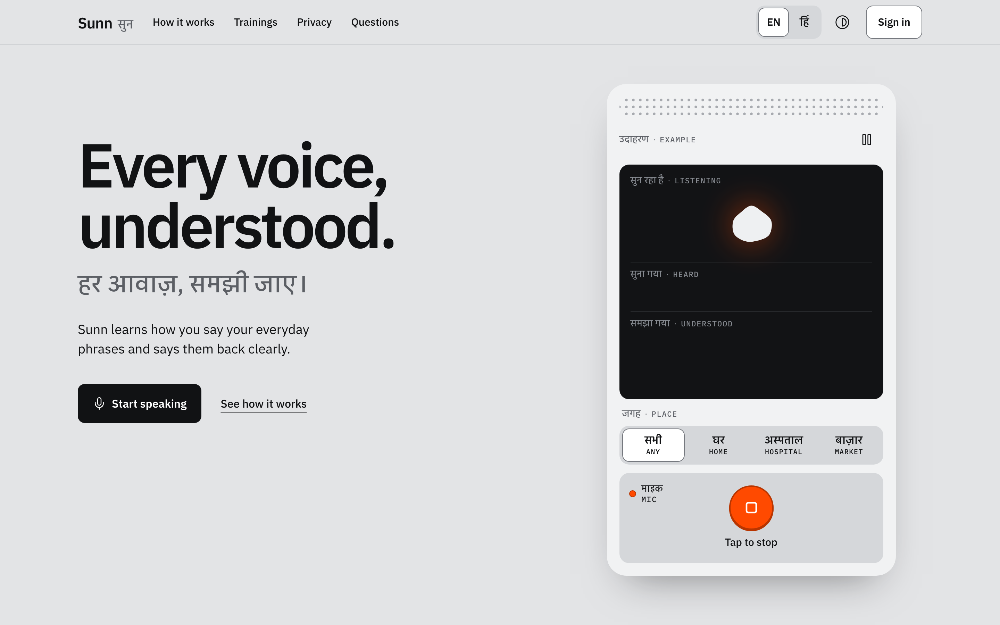 | 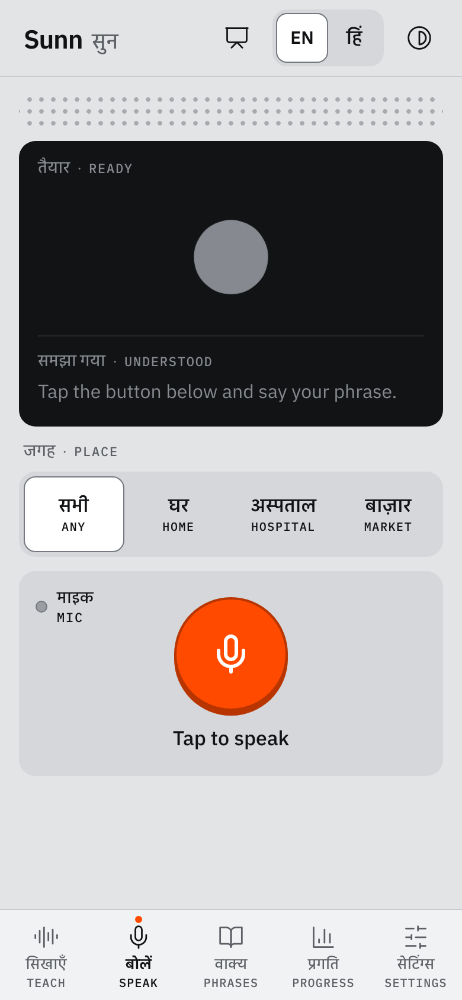 |  |

| Personal Phrase Library | Personal Progress Dashboard | Accessibility & Settings |
| :---: | :---: | :---: |
| 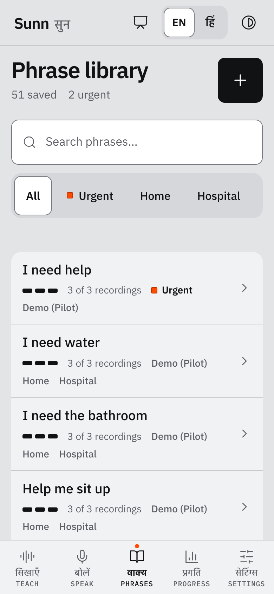 | 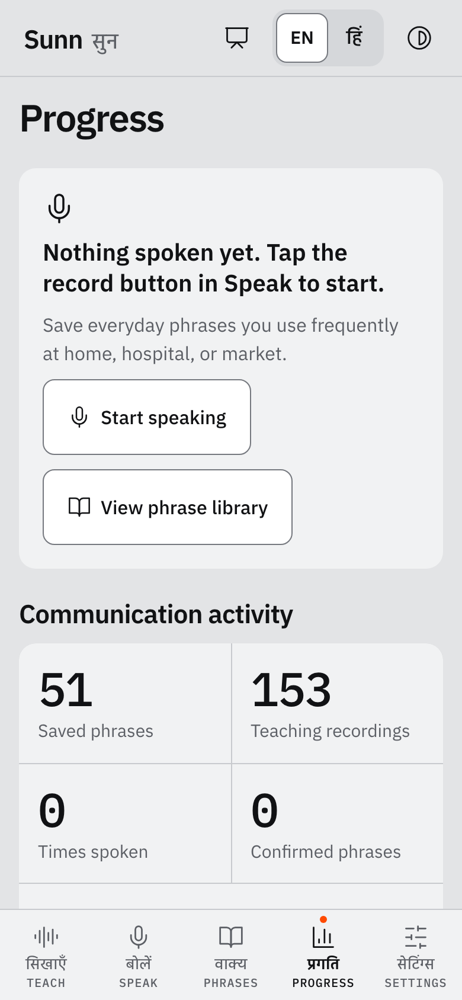 | 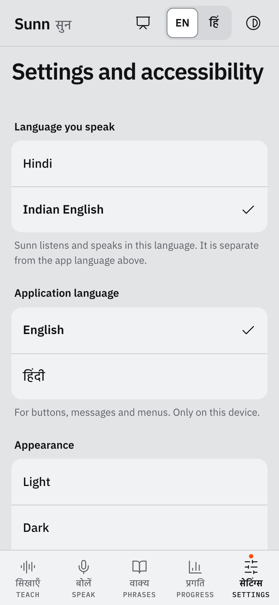 |

### Trainings & Guided Practice

| Trainings Curriculum Hub | Listen and Repeat Step | Paced Speaking Practice |
| :---: | :---: | :---: |
| 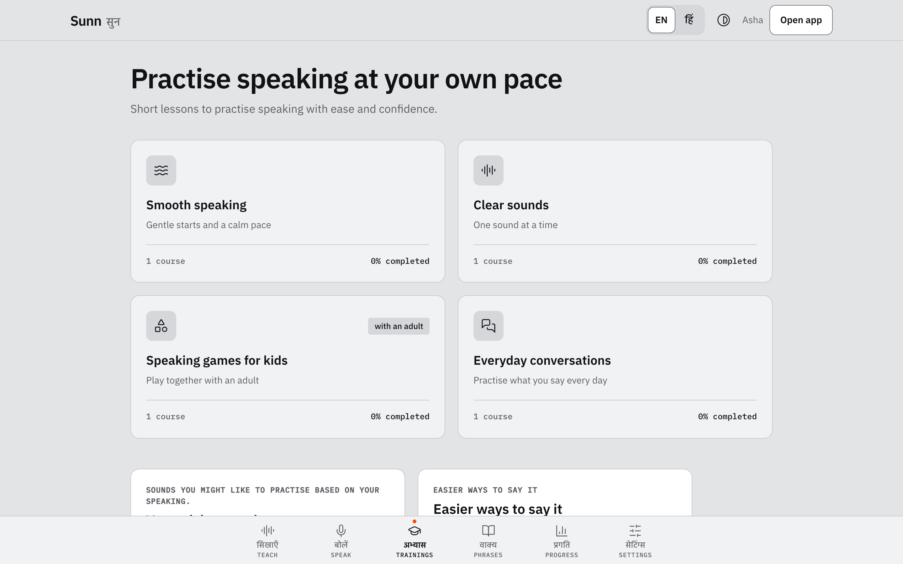 | 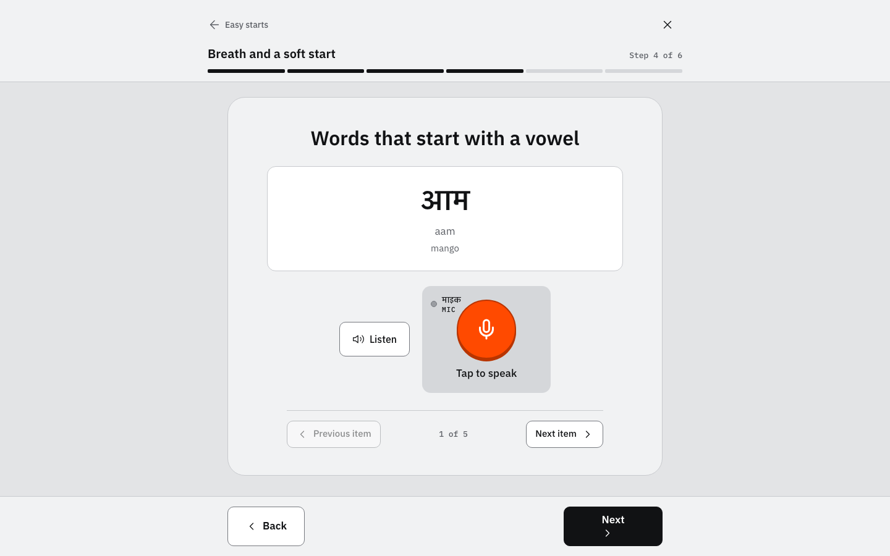 | 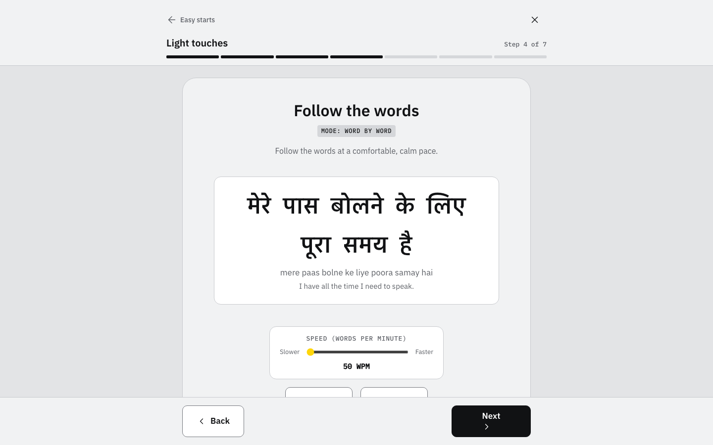 |

| Tricky Sounds Detection | Easier Ways Alternative Phrasing | Presenter Guided Walkthrough |
| :---: | :---: | :---: |
| 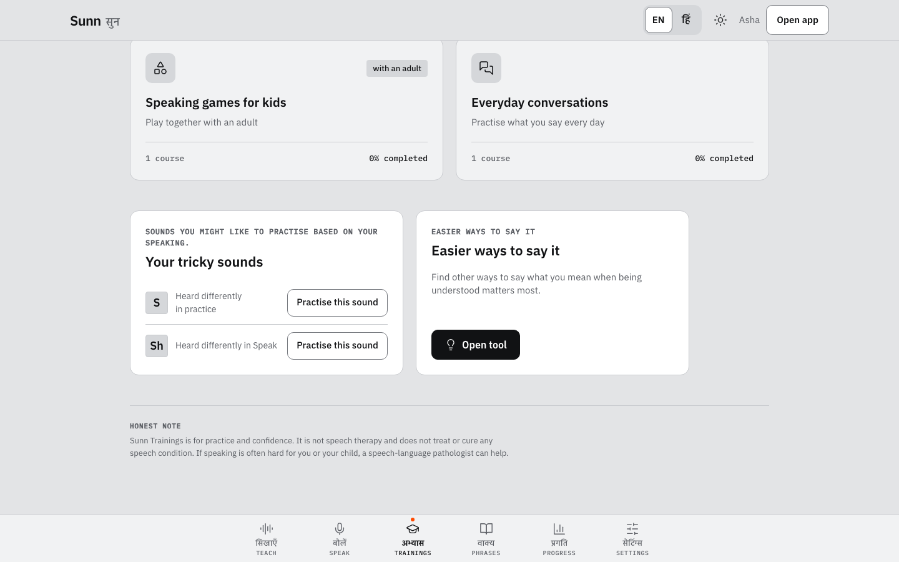 | 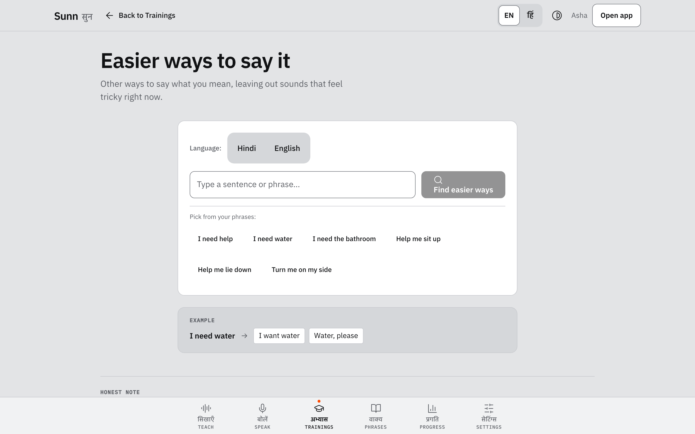 | 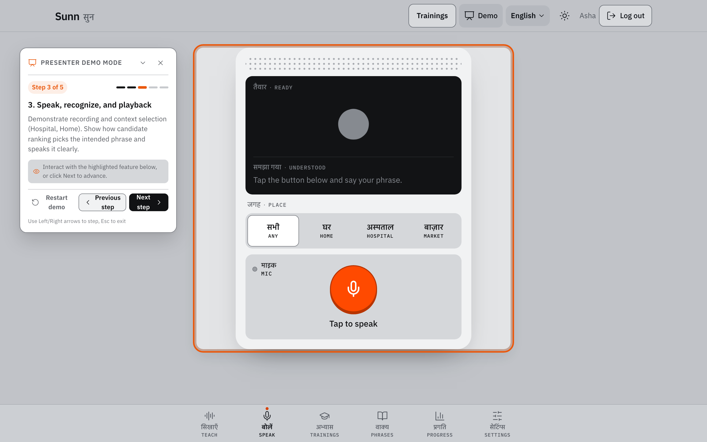 |

---

## 3. The Problem

Individuals with speech disorders and motor differences face recurring communication barriers:
- **Standard ASR Failures**: Commercial voice assistants are trained on typical speech patterns and frequently misinterpret slurred, breathy, or imprecise speech.
- **Everyday Friction**: Routine exchanges at pharmacies, clinics, transit stops, or markets often require repeating sentences, typing on phones, or relying on family members to translate.
- **Practice Isolation**: Speech practice exercises are often expensive, infrequent, and inaccessible outside clinical settings.
- **Expressive Fatigue**: Struggling to pronounce specific consonant clusters or fast multi-syllabic words causes physical exhaustion and communication avoidance.

Sunn addresses these challenges directly: it provides a personalized acoustic bridge that understands the speaker's real voice, vocalizes their intent clearly, and provides self-directed practice with zero judgment.

---

## 4. Implemented Features

### 4.1 Assistive Speak Flow
- **Real-Time Speech Capture**: Web Audio API recording with client-side waveform rendering and automatic silence detection.
- **Phonetic Matching Engine**: Dynamic Levenshtein and phonetic alignment comparing spoken hypotheses against user-enrolled reference phrases.
- **Intent Synthesis**: Tap-to-speak playback using Gnani Timbre stock voices (`Nalini` for Hindi, `Kaveri` for English) or the user's custom cloned voiceprint.
- **Context Awareness**: Contextual phrase filters (`home`, `hospital`, `market`, `urgent`) elevating relevant vocabulary.

### 4.2 Phrase Library and Template Management
- **Custom Phrase Enrollment**: Add custom everyday phrases with categorized tagging and priority flags.
- **Slot-Variable Substitution**: Template phrases (e.g., `"I want [water/tea/medicine]"`) allowing single-tap variable insertion.
- **Audio Sample Management**: Record reference audio samples per phrase to continuously train the local matcher.
- **Curated Starter Defaults**: Automatic seeding of practical everyday phrases in Hindi and Indian English upon registration.

### 4.3 Structured Trainings Curriculum
- **4 Focus Categories**:
  - `Smooth Speaking`: Rhythm, breathing control, and paced syllable pronunciation.
  - `Clear Sounds`: Consonant distinctions (`s` vs `sh`, retroflexes, plosives).
  - `Kids Speaking`: Engaging sound exploration with strict privacy (no audio transcripts stored).
  - `Everyday Talk`: Practical greetings, requests, and conversational routines.
- **Interactive Step Types**: Listen & Repeat, Read Aloud, Paced Speaking (Words Per Minute tracking), Dialogue, and Self-Reflection.
- **Persistent Progress Tracking**: Monotonic course completion percentages, resume pointers, and daily practice minute aggregation with anti-tamper caps.

### 4.4 Tricky Sounds and "Easier Ways"
- **Automated Evidence Detection**: Identifies challenging phonemes from misrecognitions, practice ratings, and self-reported difficulty.
- **Groq LLM Semantic Rewriting**: Leverages Groq Cloud (`openai/gpt-oss-120b`) to suggest fluent, natural alternative phrases that bypass difficult sounds while preserving original meaning.
- **Instant Library Addition**: One-tap action to save easier alternatives directly to the user's phrase library.

### 4.5 Accessibility, Settings and Privacy
- **Universal Design**: WCAG 2.1 AA compliant contrast ratios (minimum 4.5:1), scalable typography, and focus ring navigation.
- **Reduced Motion**: Immediate deactivation of pulse animations and canvas motion when system reduced motion or the in-app toggle is set.
- **Voice Cloning Profile**: Upload 5 to 30 seconds of speech to extract an acoustic speaker embedding stored locally in the user's data directory.
- **Complete Account Deletion**: `DELETE /me/account` cascades across all 11 database tables and purges personal audio directories on disk.

### 4.6 Presenter Demo Mode
- **Zero-Mutation Walkthrough**: Evaluators can trigger Presenter Mode (header button or `Alt+P`) to step through a guided 5-screen product tour without modifying database state or consuming API quotas.
- **Spotlight Anchors**: Interactive badges and step indicators orienting judges through Onboarding, Phrases, Speak, Settings, and Progress.

---

## 5. Supported Languages and Speech Capability Matrix

Sunn provides a clear distinction between **Interface UI Localization** and **Native Speech Processing**:

| Language | Language Code | Interface Localization | Speech Recognition (STT) | Speech Synthesis (TTS) | Custom Voice Cloning |
| :--- | :---: | :---: | :---: | :---: | :---: |
| **English** | `en` | Complete (Reviewed) | Native (`en-IN`, Prisma v2.5) | Native (`Kaveri`, Timbre v2.5) | Supported |
| **Hindi** | `hi` | Complete (Reviewed) | Native (`hi-IN`, Prisma v2.5) | Native (`Nalini`, Timbre v2.5) | Supported |
| **Tamil** | `ta` | Complete (Beta) | Hindi / English Acoustic Pipeline | English Voice Fallback | Supported |
| **Telugu** | `te` | Complete (Beta) | Hindi / English Acoustic Pipeline | English Voice Fallback | Supported |
| **Kannada** | `kn` | Complete (Beta) | Hindi / English Acoustic Pipeline | English Voice Fallback | Supported |
| **Malayalam** | `ml` | Complete (Beta) | Hindi / English Acoustic Pipeline | English Voice Fallback | Supported |
| **Marathi** | `mr` | Complete (Beta) | Hindi / English Acoustic Pipeline | Hindi Voice Fallback | Supported |
| **Gujarati** | `gu` | Complete (Beta) | Hindi / English Acoustic Pipeline | Hindi Voice Fallback | Supported |
| **Bengali** | `bn` | Complete (Beta) | Hindi / English Acoustic Pipeline | English Voice Fallback | Supported |
| **Punjabi** | `pa` | Complete (Beta) | Hindi / English Acoustic Pipeline | Hindi Voice Fallback | Supported |

> **Technical Truthfulness**: All 10 languages feature 100% translated UI strings verified by automated key parity tests. Spoken acoustic speech recognition and synthesis natively target Hindi and Indian English. Regional scripts safely fallback to Indian English or Hindi acoustic models.

---

## 6. Architecture and System Design

```mermaid
flowchart TD
    subgraph Browser ["Web Frontend (React 19 + Vite)"]
        UI[User Interface & i18n Dictionaries]
        AudioRec[Web Audio API Recorder]
        AudioPlay[HTML5 Audio Player]
        PBar[Presenter Demo Bar (Client Memory)]
    end

    subgraph Backend ["Sunn Server (FastAPI + Python 3.14)"]
        Router[API Router & Auth Middleware]
        Matcher[Phonetic Matcher & Reranker]
        PaceCalc[WPM & Pace Math Engine]
        TrickySvc[Tricky Sound Evidence Aggregator]
    end

    subgraph Storage ["Persistent Local Storage"]
        DB[(SQLite Database<br/>11 Tables)]
        AudioDisk[(Local Audio Store<br/>data/users/:id/)]
        CacheDisk[(TTS Cache Store<br/>data/cache/tts/)]
    end

    subgraph External ["External Cloud Services (Server-Side Only)"]
        Prisma[Gnani Prisma v2.5 STT<br/>api.vachana.ai]
        Timbre[Gnani Timbre v2.5 TTS<br/>api.vachana.ai]
        Groq[Groq Cloud LLM<br/>openai/gpt-oss-120b]
    end

    AudioRec -- "16kHz Mono WAV" --> Router
    Router -- "Token Verification" --> DB
    Router -- "Audio Stream" --> Prisma
    Prisma -- "Hypothesis Transcript" --> Router
    Router -- "Transcripts & Candidates" --> Matcher
    Matcher -- "Top Ranked Intent" --> UI

    UI -- "Synthesize Intent" --> Router
    Router -- "Text + Voice Config" --> Timbre
    Timbre -- "Synthesized WAV" --> AudioPlay
    Router <--> CacheDisk

    UI -- "Find Alternative Words" --> Router
    Router -- "Difficult Phonemes Prompt" --> Groq
    Groq -- "Fluent Semantic Rewrites" --> UI

    Router <--> DB
    Router <--> AudioDisk
```

---

## 7. Technology Stack

- **Frontend Client**:
  - React 19 with React Router v6.
  - Vite 8 development and production build pipeline.
  - Custom design tokens with WCAG AA compliance and reduced motion support.
  - Web Audio API with linear PCM conversion.
  - Lucide React icon library.
- **Backend Service**:
  - Python 3.12 / 3.14 with FastAPI and Uvicorn.
  - SQLite3 with parameterized queries and foreign-key integrity.
  - Password security via bcrypt with cryptographic salt rounds.
  - HTTP-only signed session cookies (`sunn_session`).
- **Speech and AI Engines**:
  - Speech-to-Text: Gnani Prisma v2.5 (`hi-IN`, `en-IN`).
  - Text-to-Speech: Gnani Timbre v2.5 (`Nalini`, `Kaveri`).
  - Voice Cloning: Gnani Vachana Voice Clone (`vachana-vc-v1`).
  - LLM Assistant: Groq Cloud API (`openai/gpt-oss-120b`).
- **Quality Engineering**:
  - Pytest with mock fixtures (`gnani_mock.py`).
  - Playwright browser test suite covering mobile (390px) and desktop (1440px).
  - Node.js test runner for i18n translation dictionary verification.

---

## 8. Repository Structure

```
sunn/
├── content/trainings/          # Curriculum JSON definitions (courses, lessons, sounds)
│   ├── categories.json         # 4 Core training categories
│   ├── courses/                # Course definitions (easy-starts, introductions, etc.)
│   └── sounds.json             # Phoneme taxonomy and evidence rules
├── data/                       # Default phrase seed files (English and Hindi)
├── docs/                       # Project engineering documentation and audits
│   ├── DYNAMIC_FUNCTIONALITY_AUDIT.md # End-to-end data flow and database audit
│   ├── AUDIT.md                # WCAG accessibility and technical audit
│   ├── DEPLOY.md               # Docker container and Hugging Face deployment
│   ├── DEMO_RUNBOOK.md         # Evaluator demonstration runbook
│   └── screenshots/            # Visual showcase gallery across devices
├── scripts/                    # Operational and evaluation utilities
│   ├── deploy_space.py         # Hugging Face Spaces staging validation
│   ├── seed_demo_user.py       # Deterministic demo user population
│   └── validate_trainings.py   # Training content schema validator
├── src/                        # FastAPI backend application
│   ├── api.py                  # Authentication, speak, phrases, and settings routes
│   ├── db.py                   # SQLite schema, migrations, and transactional helpers
│   ├── gnani.py                # Gnani Prisma and Timbre HTTP client with retry logic
│   ├── gnani_mock.py           # Zero-cost local mock provider for development/testing
│   ├── matcher.py              # Levenshtein distance and phonetic alignment
│   ├── server.py               # Single-port production server (API + static SPA)
│   ├── speak.py                # Speech synthesis and voice cloning pipelines
│   └── trainings.py            # Curriculum progress, attempts, and tricky sounds API
├── tests/                      # Automated test suites (225 tests)
│   ├── test_api.py             # API contracts and phrase CRUD
│   ├── test_gnani_hardening.py # Gnani STT/TTS retry, timeout, and validation tests
│   ├── test_groq_hardening.py  # Groq LLM integration and rate-limiting tests
│   ├── test_privacy.py         # Multi-user data isolation and deletion tests
│   └── test_trainings.py       # Curriculum progress, pace math, and cross-user isolation
├── web/                        # React 19 frontend application
│   ├── src/
│   │   ├── i18n/               # 10 Regional translation dictionaries (en, hi, ta, etc.)
│   │   ├── trainings/          # Trainings home, course viewer, and step player
│   │   ├── App.jsx             # React router configuration
│   │   ├── PresenterBar.jsx    # Guided demo tour overlay
│   │   ├── Speak.jsx           # Assistive speak screen
│   │   └── Phrases.jsx         # Personal phrase library screen
│   └── e2e/                    # Playwright end-to-end browser specifications
├── Dockerfile                  # Self-contained production container image
└── pyproject.toml              # Python dependencies and project metadata
```

---

## 9. Getting Started

### Prerequisites
- Python 3.12 or 3.14 with [`uv`](https://github.com/astral-sh/uv) package manager.
- Node.js 20+ and npm.
- Chromium browser (for Playwright testing).

### Local Setup Instructions

1. **Clone the repository**:
   ```bash
   git clone https://github.com/ARYANPATEL-BIT/sunn.git
   cd sunn
   ```

2. **Backend Installation**:
   ```bash
   # Install Python dependencies via uv
   uv sync
   ```

3. **Frontend Installation**:
   ```bash
   cd web
   npm install
   cd ..
   ```

4. **Environment Configuration**:
   ```bash
   cp .env.example .env
   # Edit .env with your credentials, or leave GNANI_MOCK=1 for zero-cost local testing
   ```

5. **Start Local Development Servers**:
   ```bash
   # Terminal 1: Backend API (port 8000)
   GNANI_MOCK=1 uv run uvicorn api:app --app-dir src --port 8000

   # Terminal 2: Frontend Web App (port 5173)
   cd web && npm run dev
   ```
   Open `http://localhost:5173` in your browser.

6. **Single-Port Production Mode**:
   ```bash
   # Build the frontend assets
   cd web && npm run build && cd ..

   # Run single-port unified server on port 7860
   GNANI_MOCK=1 uv run src/server.py --port 7860
   ```
   Open `http://localhost:7860`.

---

## 10. Environment Variables

All external service credentials reside strictly on the server:

| Variable | Required | Default | Description |
| :--- | :---: | :---: | :--- |
| `GNANI_STT_API_KEY` | Optional | `""` | Gnani Prisma Speech-to-Text token |
| `GNANI_TTS_API_KEY` | Optional | `""` | Gnani Timbre Text-to-Speech token |
| `GNANI_ACCESS_TOKEN` | Optional | `""` | Legacy fallback Gnani API token |
| `GNANI_MOCK` | Optional | `0` | Set `1` to run local mocked speech answers without API calls |
| `GROQ_API_KEY` | Optional | `""` | Groq Cloud API key for semantic alternatives |
| `GROQ_MODEL` | Optional | `openai/gpt-oss-120b` | Groq model identifier |
| `LLM_ENABLED` | Optional | `true` | Enable or disable LLM alternative phrasing |
| `LLM_TIMEOUT_S` | Optional | `3` | Maximum timeout for LLM inference |
| `SUNN_DATA_DIR` | Optional | `data` | Directory for SQLite database and audio files |
| `DEMO_INVITE_CODE` | Optional | `""` | Optional invite passcode for registration gates |

> **Credit Conservation Guarantee**: Setting `GNANI_MOCK=1` enables full local speech simulation, ensuring development and automated testing consume **0** live Gnani credits.

---

## 11. API Overview

The Sunn backend exposes 28 REST endpoints:

| Endpoint Group | Method | Path | Description |
| :--- | :---: | :--- | :--- |
| **Auth** | `POST` | `/auth/signup` | Register new user and auto-populate default phrases |
| | `POST` | `/auth/login` | Authenticate and issue secure session cookie |
| | `GET` | `/auth/me` | Fetch active authenticated user profile |
| | `POST` | `/auth/logout` | Clear session cookie |
| **Speak** | `POST` | `/speak/transcribe` | Transcribe speech audio via Prisma STT |
| | `POST` | `/speak/synthesize` | Vocalize text via Timbre TTS or cloned voice |
| | `POST` | `/me/uses` | Log completed communication interaction |
| **Phrases** | `GET` | `/me/phrases` | List user phrases, categories, and slot variables |
| | `POST` | `/me/phrases` | Create custom phrase |
| | `PUT` | `/me/phrases/:id` | Update phrase text, category, or urgent status |
| | `DELETE` | `/me/phrases/:id` | Delete phrase and associated audio samples |
| | `POST` | `/me/phrases/:id/samples` | Upload reference voice recording for phrase |
| | `POST` | `/me/phrases/default` | Re-seed default everyday phrases |
| **Trainings** | `GET` | `/trainings/categories` | List 4 training categories with completion rates |
| | `GET` | `/trainings/categories/:id` | List courses within a category |
| | `GET` | `/trainings/courses/:id` | List lessons and step sequence for a course |
| | `GET` | `/trainings/lessons/:id` | Fetch step content for interactive lesson |
| | `GET` | `/trainings/audio/:key` | Stream reference pronunciation audio |
| | `GET` | `/me/trainings/progress` | User practice stats, resume pointer, and streaks |
| | `POST` | `/me/trainings/progress` | Record lesson step completion |
| | `POST` | `/me/trainings/attempts` | Submit speech practice recording for pace/WPM math |
| | `POST` | `/me/trainings/reflect` | Submit self-assessment feeling (`confident`/`okay`/`hard`) |
| | `GET` | `/me/trainings/tricky-sounds` | Retrieve user tricky sounds based on evidence |
| | `POST` | `/me/trainings/alternatives` | Generate easier phrasing alternatives via Groq |
| **Account** | `POST` | `/me/voice` | Upload reference voice for custom voice cloning |
| | `DELETE` | `/me/voice` | Purge custom cloned voiceprint |
| | `DELETE` | `/me/account` | Permanently delete user account and all personal data |
| **System** | `GET` | `/health` | Service health status and readiness check |

---

## 12. Automated Quality Gates and Test Verification

Sunn maintains an exhaustive verification suite across backend and frontend:

```bash
# 1. Run all backend unit and integration tests (225 tests)
GNANI_MOCK=1 uv run pytest

# 2. Run i18n translation key parity checks (10 languages)
node --test web/src/i18n/strings.test.js

# 3. Build frontend assets for production
cd web && npm run build && cd ..

# 4. Run Playwright end-to-end browser tests across viewports (155 tests)
cd web && npx playwright test

# 5. Verify deployment file packaging (476 files)
uv run scripts/deploy_space.py --check-only
```

### Verified Test Results
- **Pytest**: `225 passed` (100% pass rate in 18.8s).
- **Playwright**: `155 passed, 1 skipped` (the 1 skipped test is for live hardware microphone capture on headless CI).
- **i18n Parity**: `10/10 languages passed` with 100% translation key coverage.
- **Space Deployment Check**: `476 files validated` cleanly for container staging.

> **Deprecation Notice Note**: 88 warnings are emitted by Python 3.14 regarding `codecs.open()` in the third-party `indic_transliteration` library. These are upstream deprecation warnings and do not affect runtime functionality. 1 warning from Starlette TestClient relates to test timeouts and has zero production impact.

---

## 13. Privacy and Data Safety

- **User Data Isolation**: Every database query is strictly scoped by `user_id = ?`. User A cannot access User B's phrases, recordings, or progress.
- **Local Audio Storage**: Recordings and voice embeddings are partitioned in user-specific local directories (`data/users/:id/`).
- **Child Privacy**: Lessons in the `kids-speaking` category do not persist speech transcripts to disk or database.
- **Zero Log Leakage**: Server logs (`logs/app.log`) capture operational metrics, timings, and status codes. Personal audio, phrase text, passwords, and tokens are never logged.
- **Full Account Deletion**: `DELETE /me/account` completely removes user records from all SQLite tables and purges audio directories on disk.

---

## 14. Known Limitations

- **Speech Pipeline Scope**: Speech-to-text (Prisma) and speech-synthesis (Timbre) natively support Hindi (`hi-IN`) and Indian English (`en-IN`). The other 8 languages provide complete interface translations, with speech processing defaulting to Hindi or English models.
- **Voice Cloning Fidelity**: Creating an effective custom voice clone requires 5 to 30 seconds of clean audio with minimal background noise.
- **Microphone Permissions**: The browser must be served over `https://` or `localhost` to grant Web Audio API microphone recording permissions.

---

## 15. Demonstration Guide

To evaluate Sunn during a live demonstration:

1. **Launch Presenter Mode**: Click the **Demo** button in the app header (or press `Alt + P` / `Option + P`).
2. **Step 1 - Onboarding**: Experience the first-run welcome tour explaining Sunn's mission.
3. **Step 2 - Phrase Library**: Review everyday categorized phrases, slot-variable templates, and context tags (`home`, `hospital`).
4. **Step 3 - Assistive Speak**: Tap the microphone to simulate speech input, inspect top phonetically ranked candidate matches, and listen to synthesized speech.
5. **Step 4 - Accessibility & Voice Cloning**: Explore large text scaling, reduced motion mode, and custom voiceprint configuration.
6. **Step 5 - Personal Progress**: Inspect completed lessons, daily practice minutes, and weekly activity streaks.
7. **Curriculum & Easier Ways**: Navigate to `/trainings` to practice a 5-step lesson and visit `/trainings/easier-ways` to view Groq-generated alternative phrasing.

---

## 16. Roadmap

### Completed Capabilities
- Full dual-language native speech pipeline (Hindi and Indian English).
- 10-Language complete Indian interface localization.
- 16-Lesson structured practice curriculum with WPM pace tracking.
- Groq LLM semantic alternative phrasing engine.
- Presenter guided demonstration mode.
- Complete responsive design from 320px mobile to 1440px desktop.

### Planned Enhancements
- Direct acoustic speech-to-text integration for additional Indian languages (Tamil, Telugu, Bengali) as provider models become available.
- Offline-capable on-device speech models for low-connectivity rural environments.
- Caregiver and speech-language therapist remote progress sharing portal.

---

## 17. Contributors and Team

Sunn is developed by:
- **Aryan Patel** ([ARYANPATEL-BIT](https://github.com/ARYANPATEL-BIT))
- **Tuhin Mondal** ([tuhinbuilds](https://github.com/tuhinbuilds))

Built for **Gnani AI's Great Indian AI Challenge**.

---

## 18. License

No license has been specified for this repository. All rights reserved by the project authors.
