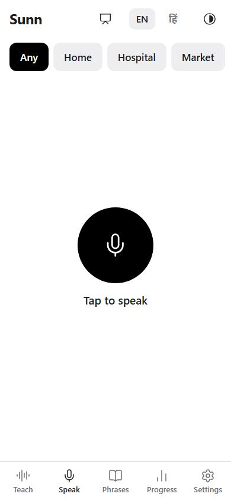
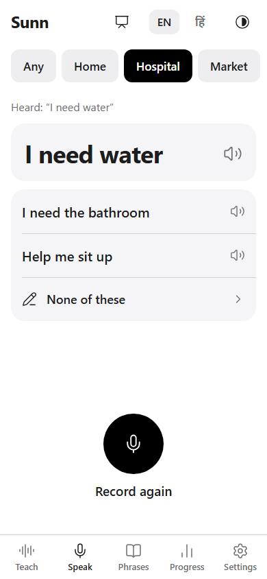
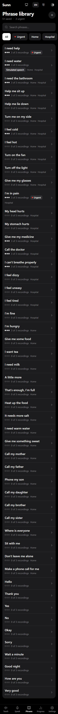
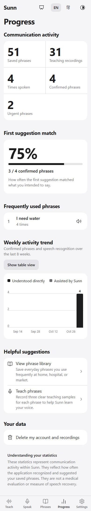
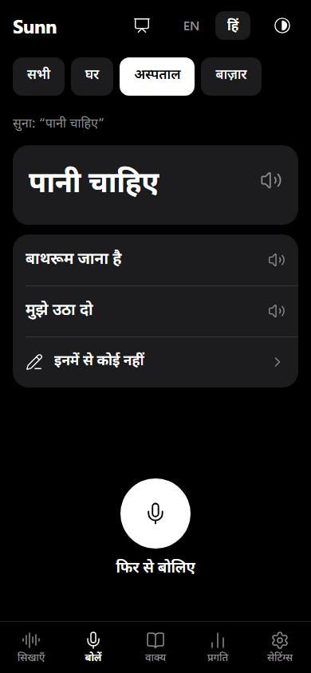
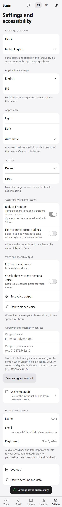
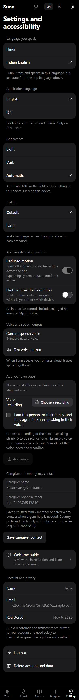
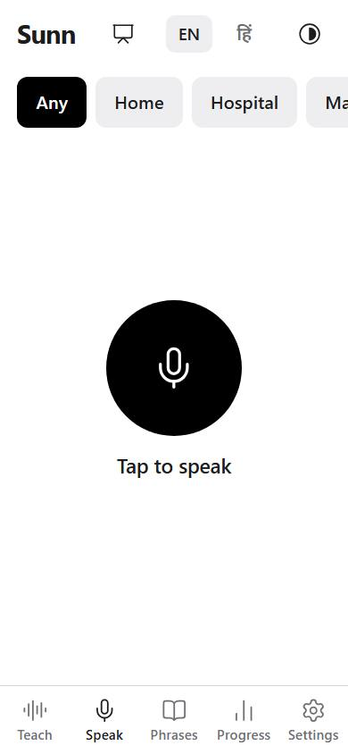
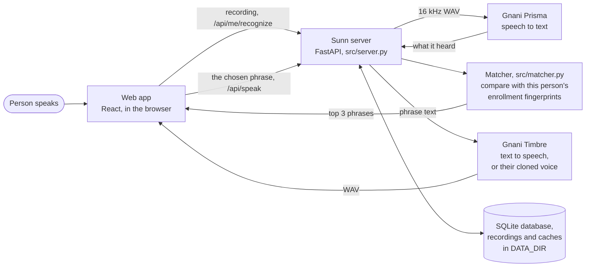

# Sunn (सुन)

> An accessibility speech assistant for individuals with dysarthria and atypical speech patterns, powered by Gnani AI's Prisma STT and Timbre TTS.

[](https://fastapi.tiangolo.com)
[](https://react.dev)
[](https://python.org)
[](tests/)
[](docs/AUDIT.md)
[](web/e2e/)
[](https://gnani.ai)

---

Sunn is an assistive speech communication aid engineered for individuals whose speech is difficult for unfamiliar listeners and general automatic speech recognition (ASR) engines to understand. Users speak everyday phrases in their natural voice, and Sunn identifies what was intended and vocalizes it clearly in Hindi (`hi-IN`) or Indian English (`en-IN`).

Built for **Gnani AI's Great Indian AI Internship Challenge**.

---

## Interface & Screen Walkthrough

Sunn is designed mobile-first with high-contrast visual themes, minimum 44px accessible touch targets, and full bilingual support in Hindi and Indian English.

| Speak & Listen | Recognition Candidates | Phrase Library | Progress Trends |
| :---: | :---: | :---: | :---: |
|  |  |  |  |

| Hindi Bilingual Mode | Own Voice Setup | Accessibility Controls | Large Text Display |
| :---: | :---: | :---: | :---: |
|  |  |  |  |

> Complete visual reference: [248-screenshot UI gallery](docs/screenshots/README.md) covering every screen, sheet, and state in English and Hindi, light and dark, at phone and desktop width.

---

## The problem

Dysarthria is a speech disorder caused by conditions such as stroke, Parkinson's disease,
cerebral palsy or ALS. Words come out slurred, slow or uneven. Family members often learn to
understand the person, but strangers, nurses and shopkeepers often can't, and general speech
recognition, trained mostly on typical speech, often gets it wrong too. That leaves the person
pointing, writing, or waiting for someone to translate for them.

The people Sunn is for are dysarthric speakers of Hindi or Indian English, and the family
members or caregivers who help them set it up.

## How it works



1. **Enroll.** The person (or a helper) picks everyday phrases (51 come built in, like पानी
   चाहिए or "I need help") and records each one about 3 times. Sunn sends each recording to
   Prisma and stores what Prisma heard: its *hypothesis*.
2. **Speak.** Later the person says one of those phrases. Prisma transcribes it, and Sunn
   compares that transcript with every stored hypothesis and shows the 3 closest phrases.
3. **Confirm.** The person taps the right one and Timbre says it aloud. The confirmed
   recording joins that phrase's examples, so Sunn learns from use.

### The error fingerprint idea

Sunn doesn't try to correct Prisma or to train a speech model. It uses Prisma's mistakes.

When Prisma mishears a particular person saying a particular phrase, it tends to mishear it
in a similar way each time. Say "पानी चाहिए" comes back as "बानी चाई" again and again. That
consistent wrong transcript is a fingerprint of the phrase in this person's voice. Sunn keeps
the fingerprints from enrollment, and at speaking time it asks which phrase's fingerprints
the new transcript is closest to, instead of whether the transcript is right.

That is why it needs little data: there is no model to train, only a few transcripts to
store. A phrase is usable after about 3 recordings, a new phrase can be added at any time by
recording it, and everything is per person, so one person's patterns never get averaged with
anyone else's. It also means Sunn can only ever pick a phrase the person has enrolled, and it
only works as well as Prisma's mistakes are consistent (see Limitations).

The details, all in `src/matcher.py`:

- Both texts are normalized: Devanagari is transliterated to ITRANS (so Devanagari and
  romanized output compare fairly), lowercased, and reduced to letters, digits and spaces.
- Similarity is normalized Levenshtein similarity, 0–100. A phrase scores as its closest
  fingerprint.
- Small boosts settle near ties: +6 when the phrase is tagged with the place the person
  chose (home, hospital, market), up to +4 for how often they use it, up to +3 for how often
  they use it at this time of day. Together they add at most 13, never enough to beat a
  clearly closer match.
- A best similarity under 60 is flagged as low confidence.
- **Building blocks**: a template like `{item} चाहिए` or `Call {person}` and its slot words
  (पानी, "the nurse") are recorded separately, and Sunn joins their fingerprints. So
  "चाय चाहिए" can be recognized without ever being recorded as a whole.

## How Gnani's APIs are used

All calls go through `src/gnani.py`: a 15 s timeout, one retry after a timeout, a lost
connection or a 5xx, and a row in the `api_calls` table for every request.

- **Prisma speech to text** (`https://api.vachana.ai/stt/v3`, `src/prisma.py`). Every
  recording is converted to 16 kHz mono 16-bit WAV with ffmpeg (bundled in `imageio-ffmpeg`)
  and sent with `language_code` `hi-IN` or `en-IN` (the person's language) and `format`
  `verbatim`. Used twice: at enrollment, where the transcript becomes a fingerprint, and at
  speaking time, where it is matched against them. Sunn never shows Prisma's transcript as the
  answer; it only uses it for matching.
- **Timbre text to speech** (`https://api.vachana.ai/api/v1/tts/inference`, model
  `timbre-v2.5`, `src/speak.py`). Says the chosen phrase with voice Nalini (`hi-IN`) or Kaveri
  (`en-IN`), as a 48 kHz WAV.
- **Voice cloning** (`https://api.vachana.ai/api/v1/tts/voice-clone/embeddings`, then the
  same inference endpoint with model `vachana-vc-v1`). Optional, and only with separate
  consent: from 5–30 s of the person's own speech, Sunn can speak in a voice like theirs. Only Gnani's embedding is kept, never the
  recording.

Every Prisma transcript and Timbre clip is cached on disk under `DATA_DIR/cache/` by a hash
of the audio or text and the full request, so the same request is never paid for twice.

## Features

- **Quick-Start Gated Enrollment**: 10 essential everyday phrases (Help, Pain, Water, Bathroom, Yes, No, Hungry, Medicines, Emergency, Call Caregiver) are recorded first (3 takes each). The Speak screen unlocks once these foundational phrases are trained.
- **Dual Language Independence**: Complete separation of UI display language (instant English / Hindi switch in the navigation header) from the user's spoken account language (configured in Settings with safety checks).
- **Sign-up with consent and optional invite code**: Sign-in with secure httpOnly session cookies.
- **51 built-in everyday phrases**: Pre-configured in Hindi and English, tagged by place (Home, Hospital, Market), with "I need help" and "I'm in pain" marked urgent.
- **Speaking & Recognition**: Tap to record, then pick from the top 3 candidates, which Timbre says aloud. Contextual ranking, urgent badges, and low-confidence warnings.
- **In-App Own Voice Cloning**: Upload 5 to 30 seconds of speech in Settings with separate explicit consent to activate personalized synthesis.
- **Phrase Library**: Full CRUD support: search, add, edit, tag, mark urgent, and delete phrases.
- **Caregiver Contact**: One-tap WhatsApp emergency alert link.
- **Transparent Progress Tracking**: Phrase and recording counts, top-1 hit rate, most used phrases, and weekly Prisma accuracy trends.
- **Accessibility Controls**: Large text display, high-contrast focus outlines, and reduced motion toggles adhering to WCAG AA guidelines.
- **Credit Protection**: Global server limit (`GNANI_CALL_LIMIT`) and per-user daily limits (`DAILY_CALL_CAP_PER_USER`).

## Gnani Mock Mode (Zero Credit Offline Testing)

Sunn includes a comprehensive offline mock engine (`src/gnani_mock.py`, `src/gnani_mock.json`) that allows evaluators, judges, and developers to test the entire application end-to-end without spending API credits or configuring an API key:

```bash
GNANI_MOCK=1 uv run src/server.py --port 7860
```

- Answers Prisma STT, Timbre TTS, and voice cloning locally with deterministic fixture responses.
- **Safety Guard**: Mock Mode automatically refuses to start if `TRUST_PROXY=1` is set, ensuring it can never accidentally run in public production deployments.

## Shared-Model Machine Learning Experiment (`training/`)

In addition to per-speaker acoustic error fingerprinting, the repository includes a complete machine learning research module in `training/` exploring shared acoustic models for dysarthric speech:

- **Objective**: Evaluates whether parameter-efficient fine-tuning (PEFT LoRA) of `openai/whisper-small` across multiple dysarthric speakers can improve baseline transcription compared to generic commercial ASR.
- **Speaker-Split Data Pipeline** (`training/data.py`): Enforces strict speaker isolation between training and evaluation splits using TORGO corpus and pilot recordings, guaranteeing zero speaker data leakage.
- **LoRA Training Module** (`training/train.py`): Implements 8-bit quantized LoRA fine-tuning targeting Whisper attention projection layers (`q_proj`, `v_proj`) with PyTorch CUDA 12.8 support via optional `[dependency-groups.train]`.
- **Zero-Leakage Evaluation Gate** (`training/evaluate.py`): Asserts Word Error Rate (WER) and Character Error Rate (CER) baselines with formal non-leakage verification.
- **Production Isolation**: Training scripts, checkpoints, and adapter weights are explicitly excluded from Docker container builds (`.dockerignore`) and git tracking (`.gitignore`) to keep runtime deployments lightweight.

> See [`training/README.md`](training/README.md) for full training scripts, hyperparameter configurations, and evaluation benchmarks.

## Results

**Not measured yet for this version.** No evaluation has been run on real or demo recordings
of the current matcher, so there are no numbers to report here. Nothing below should be read
as a result until this section links real charts.

How it will be measured (`scripts/evaluate.py`, docs/DEMO_DATA.md): a demo account is
enrolled from a folder of recordings, and recordings held out of enrollment are run through
the same matching. It reports raw Prisma exact-match accuracy, Sunn's top-1 and top-3
accuracy, the effect of the place context, and accuracy with 1, 2 or 3 enrollment recordings
per phrase, overall and separately for each source of speech (`pilot`: a real person who
consented; `torgo`: the TORGO dysarthric speech corpus; `simulated`: imitated unclear speech,
which says nothing about real users). Every chart title states the source and the number of
recordings, and every run is reported, including bad numbers.

<!-- After running scripts/evaluate.py, replace the paragraph above with the real numbers from
results/eval_<account>.csv and link the charts, with their data source:


 -->

## Limitations

- **A fixed phrase set.** Sunn picks from phrases the person has enrolled. It can't
  understand new sentences; anything new has to be added and recorded first.
- **It depends on Prisma's mistakes being consistent.** If the same phrase comes back very
  differently each time, or two phrases come back alike, Sunn will pick the wrong one. Short
  phrases and phrases that sound alike are the hardest.
- **It needs the internet.** Every recognition is a Prisma call and every new phrase spoken
  is a Timbre call. Nothing works offline except what's cached.
- **The demo host resets.** The public demo runs on a free Hugging Face Space, which sleeps
  when idle and loses all accounts and recordings whenever it restarts (docs/DEPLOY.md).
- **Not tested with enough people.** See Results.
- **Not a medical device.** Sunn is a communication aid. It doesn't diagnose, treat or
  measure speech, and the progress screen is a usage trend, not a clinical measure. Don't
  rely on it alone in an emergency.

## Privacy and consent

- Sign-up needs explicit consent (`consent_given_at` is stored). Voice cloning needs a second,
  separate consent (`voice_consent_given_at`).
- Recordings are sent to Gnani for transcription. They are stored on the Sunn server under
  `DATA_DIR/users/<id>/`, and no endpoint serves them back.
- Every per-user route takes the user from the session cookie, never from the URL. Another
  person's ids answer 404, and every update and delete is scoped to the signed-in user.
- `DELETE /api/me` deletes the account and everything it made: phrases, building blocks,
  recordings, their cached transcripts, and the cloned voice with everything spoken in it.
  `DELETE /api/me/voice` forgets just the voice. Kept: the stock-voice Timbre cache (phrase
  text in Nalini's or Kaveri's voice, not tied to anyone) and call counts, which are no
  longer tied to the account.
- Logs (`logs/app.log`) hold ids, counts and codes only. Passwords, tokens, emails, audio
  paths, phrase text and transcripts are redacted.
- Passwords are hashed with argon2. Failed logins are limited per email and wrong invite
  codes per IP address.
- Demo data from real people needs their informed consent first, and TORGO's licence must
  be checked before its recordings are used publicly (docs/DEMO_DATA.md).

## Run it locally

Needs [uv](https://docs.astral.sh/uv/) and Node 20.19+ (or 22.12+), on Windows PowerShell:

```powershell
uv sync
Copy-Item .env.example .env   # then fill in GNANI_API_KEY and a JWT_SECRET:
uv run python -c "import secrets; print(secrets.token_urlsafe(48))"

cd web; npm ci; npm run build; cd ..
uv run src/server.py          # the app on http://127.0.0.1:7860, API docs at /api/docs, health at /api/health
```

Desktop browsers treat `localhost` as a secure context, so the microphone works on
http://localhost:7860. All settings are in `.env.example`.

While working on the frontend, run the API and Vite's dev server instead, for hot reload:

```powershell
uv run uvicorn api:app --app-dir src --port 8000   # terminal 1
cd web; npm run dev                                 # terminal 2: http://localhost:5173, proxies /api to :8000
```

On a phone, the microphone needs https. Run `npm run tunnel` in `web/` (needs `cloudflared`:
`winget install Cloudflare.cloudflared`) for a temporary `https://*.trycloudflare.com`
address. Anyone with that address can reach your dev server while it runs, so stop it when
you're done. For LAN https with mkcert, put `cert.pem` and `key.pem` in `web/certs/`.

The web app's design system is in `web/DESIGN.md`.

### Demo data and evaluation

```powershell
uv run scripts/load_demo.py --email demo@example.com --folder data/demo
uv run scripts/evaluate.py --email demo@example.com --folder data/demo
```

How to record and organize the folder, and the consent it needs, is in docs/DEMO_DATA.md.

## Presenter Demo Guide (3 to 5 Minutes)

Sunn includes a built-in Presenter Mode to help demo the app reliably to judges, mentors, and partners.

### 1. Starting the Application
```powershell
# Terminal 1: Backend API (port 8000)
uv run uvicorn api:app --app-dir src --port 8000

# Terminal 2: Web frontend (http://localhost:5173)
cd web; npm run dev
```
Open `http://localhost:5173` in a desktop browser (Chrome, Edge, or Firefox). Desktop localhost is treated as a secure origin, so microphone permissions work without TLS certificates.

### 2. Activating Presenter Mode
- Click the **Demo** pill in the top header, or press **Alt + P** (**Option + P** on macOS).
- The Presenter Cue Bar docks near the top of the screen with step-by-step cues, quick-jump pills, and progress indicators.
- Presenter Mode can be collapsed with the chevron or exited anytime with the close button or **Alt + P**.

### 3. Step-by-Step Demo Journey (Approx. 4 Minutes)
1. **Step 1: Onboarding and Language Setup (0:00 to 0:45)**:
   - Jump to Onboarding (`/app/onboarding`).
   - Explain Sunn's core mission: an assistive communication aid for people whose speech is difficult to understand.
   - Show the 3-recording learning principle, and the guide's language step, which changes only the screen's language (the language spoken is in Settings).
2. **Step 2: Personal Phrase Library (0:45 to 1:30)**:
   - Jump to Phrase Library (`/app/phrases`).
   - Point out everyday phrases, context tags (home, hospital, market), and urgent tags.
   - Point out the demo source badges: `Demo (Pilot)` marks recordings by a consenting pilot speaker, `Demo (TORGO)` the TORGO corpus, and `Simulated speech` someone imitating unclear speech; phrases without a badge were recorded in the app.
3. **Step 3: Speak, Recognize, and Synthesis (1:30 to 3:00)**:
   - Jump to Speak Screen (`/app/speak`). It opens once the 10 quick-start phrases have 3 recordings each, so use a demo account loaded with `scripts/load_demo.py`, or record them on Teach first.
   - Select a context (e.g. `Hospital` or `Home`) to show contextual ranking.
   - Tap the Sun to speak, then tap again. Show the three closest phrases, best first (the screen shows no scores; `/api/docs` shows each candidate's score parts).
   - Tap a candidate to confirm and hear clear speech output.
4. **Step 4: Accessibility and Voice Cloning (3:00 to 3:45)**:
   - Jump to Settings (`/app/settings`).
   - Demonstrate accessibility controls: Large text, High-contrast focus outlines, and Reduced motion.
   - Show own voice: upload 5-30 s of the person's speech with its own consent (`voice_consent_given_at`), turn it on, and Speak uses it.
5. **Step 5: Transparent Metrics and Privacy (3:45 to 4:30)**:
   - Jump to Progress (`/app/progress`).
   - Clarify the metrics: the weekly trend counts how often Prisma's own transcript already matched the confirmed phrase. It is a usage trend, not a clinical measure.
   - Show account deletion (`DELETE /me`): it removes the account, its phrases, recordings, cached transcripts and cloned voice. Only call counts and the shared stock-voice cache stay, tied to no one.

### 4. Handling Failures and Fallbacks During Presentations
- **Microphone permission blocked**: The screen displays an inline troubleshoot guide with instructions to allow access in the browser address bar.
- **Speech service unavailable**: If Timbre fails (limits, errors, or no connection), playback falls back to the browser's own speech synthesis (`window.speechSynthesis`), with a note on screen. Recognition needs Prisma, so speaking stops working until it is back.
- **Demo data transparency**: Every pre-enrolled phrase displays its origin badge so judges always know whether data is pilot-recorded or simulated.

### Demo and Submission Resources
- **Live Service Dependency Matrix**: `docs/DEMO_MATRIX.md` documents cloud services, cache behavior, and fallback mechanisms.
- **Step-by-Step Demonstration Runbook**: `docs/DEMO_RUNBOOK.md` provides the exact presentation script and timing.
- **Demo Video Recording Plan**: `docs/DEMO_VIDEO_PLAN.md` provides the 3-minute video storyboard and narration text.
- **Challenge Submission Checklist**: `docs/SUBMISSION_CHECKLIST.md` tracks deliverables and manual team actions.
- **Challenge Write-Up**: `docs/WRITEUP.md` provides the problem statement, solution architecture, and differentiators.

## Deploy

One Docker image (`Dockerfile`) serves the API under `/api` and the web app everywhere else
on port 7860. docs/DEPLOY.md has the exact steps for a free Hugging Face Docker Space: the
secrets to add (including `TRUST_PROXY=1` and `DEMO_INVITE_CODE`), how to push with
`scripts/deploy_space.py`, and what to
expect (it sleeps when idle and loses its data on restart).

## Verification & Accessibility Audit (`docs/AUDIT.md`)

The entire application underwent a comprehensive pre-submission technical and accessibility audit documented in [`docs/AUDIT.md`](docs/AUDIT.md):

- **WCAG 2.1 AA Compliance**: All text and controls satisfy 4.5:1 contrast ratios; interactive controls enforce minimum 44x44px touch targets; complete keyboard tab navigation with high-visibility focus rings.
- **Reduced Motion Support**: Animations, pulsating indicators, and transitions instantly deactivate when `prefers-reduced-motion` or the in-app accessibility toggle is activated.
- **Security & Authorization**: Argon2 password hashing, `HttpOnly` and `SameSite=Lax` session cookies, rate-limited login lockouts, early upload payload size enforcement, and strict user-scoped route isolation.
- **Performance**: Automated Gzip compression middleware on web assets for fast low-bandwidth mobile loading.

## Tests

Sunn maintains a rigorous test suite spanning unit tests, integration contracts, security assertions, and browser end-to-end scenarios:

```bash
# Run backend pytest test suite (112 tests, 0 network calls)
uv run pytest

# Run Playwright end-to-end browser tests in mock mode (12 specs)
cd web && npx playwright install chromium && npm run e2e

# Run end-to-end HTTP smoke test on running server (requires 2 short WAVs)
uv run scripts/smoke_test.py sample1.wav sample2.wav

# Run deployment pre-flight dry run
uv run scripts/deploy_space.py --check-only
```

Each backend test runs in an isolated temporary directory with mocked Gnani endpoints, ensuring zero credit consumption. The Playwright suite tests full browser flows at 390px (mobile) and 1440px (desktop) viewports in both Hindi and English.

## Challenge Deliverables & Resources

| Deliverable | File Link | Description |
| :--- | :--- | :--- |
| **Master Submission Package** | [`docs/SUBMISSION_PACKAGE.md`](docs/SUBMISSION_PACKAGE.md) | Single-source challenge evaluation guide, architecture, and rubric mapping |
| **Verification & Accessibility Audit** | [`docs/AUDIT.md`](docs/AUDIT.md) | Pre-submission audit covering WCAG AA, security, and technical truthfulness |
| **Technical Write-Up** | [`docs/WRITEUP.md`](docs/WRITEUP.md) | Comprehensive system architecture, engineering decisions, and impact |
| **Live Demonstration Runbook** | [`docs/DEMO_RUNBOOK.md`](docs/DEMO_RUNBOOK.md) | Step-by-step evaluator journey with presenter cues and timing |
| **Demo Video Plan & Script** | [`docs/DEMO_VIDEO_PLAN.md`](docs/DEMO_VIDEO_PLAN.md) | 3-minute video recording storyboard and narration script |
| **Service & Fallback Matrix** | [`docs/DEMO_MATRIX.md`](docs/DEMO_MATRIX.md) | Cloud dependencies, caching behaviors, and fallback mechanisms |
| **Deployment Runbook** | [`docs/DEPLOY.md`](docs/DEPLOY.md) | Docker containerization, Hugging Face Space setup, and proxy security |
| **Mobile UI Screenshots** | [`docs/screenshots/README.md`](docs/screenshots/README.md) | 248 screenshots: English and Hindi, light and dark, 390 and 1440 wide |
| **Shared-Model Training Guide** | [`training/README.md`](training/README.md) | PyTorch LoRA Whisper fine-tuning experiments and data splits |
| **API Contract Specification** | [`docs/API.md`](docs/API.md) | REST API endpoints, schemas, authentication, and error codes |

## API

`docs/API.md` is the contract the web app is built against: every route, its body, an
example answer and its error codes. The live version is `/api/docs`.

## Other scripts

- `uv run src/speak.py --text "I need water" --language en`: one Timbre call, saved to
  `results/tts_test.wav`
- `src/correct.py` and `src/eval_correct.py`: the first feasibility test of the fingerprint
  idea, run on Prisma transcripts of TORGO recordings. They read
  `results/prisma_predictions.csv`, which isn't in the repo.


## Contributors

1. Aryan Patel
2. Tuhin Mondal