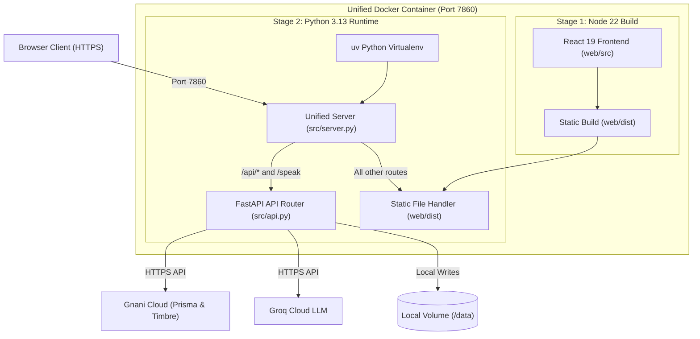

# Sunn: Deployment Readiness and Infrastructure Guide

**Repository**: https://github.com/ARYANPATEL-BIT/sunn  
**Branch**: `feature/final-codebase-audit-documentation`  
**Base Commit**: `bf39b1b4a6be9e120f3a469d479133b1e3e78361`  
**Target Environment**: Hugging Face Docker Spaces / Self-Hosted VPS / Local Tunnel  
**Date**: November 2026  

---

## 1. Deployment Architecture Overview

Sunn packages both the FastAPI backend and the compiled React 19 single-page application into a unified, self-contained Docker container image defined in [Dockerfile](file:///Users/apple/sunn/Dockerfile).



### Key Infrastructure Specifications
- **Base OS**: `python:3.13-slim` runtime on Linux.
- **Build Stage**: `node:22-slim` executing `npm run build` with Vite 8.
- **Package Manager**: Astral `uv` (v0.11.28) managing isolated virtual environment without development dependencies (`uv sync --frozen --no-dev`).
- **Security Context**: Operates strictly under non-root unprivileged user `user:1000`.
- **Unified Port**: Binds to `0.0.0.0:7860`, matching Hugging Face Spaces default port.
- **Single-Server Routing**: [src/server.py](file:///Users/apple/sunn/src/server.py) routes `/api` and `/speak` to FastAPI while serving `web/dist` with SPA fallback for all frontend client routes.

---

## 2. Complete Environment Variable Reference

The table below catalogs every environment variable supported by the Sunn application:

| Variable | Purpose | Required? | Used By | Deployment Configuration Needed? |
| :--- | :--- | :---: | :--- | :--- |
| `GNANI_STT_API_KEY` | Authenticates requests to Gnani Prisma v2.5 Speech-to-Text API. | Yes (Real Mode) | `src/gnani.py`, `src/prisma.py` | Add as Secret in Space / Container |
| `GNANI_TTS_API_KEY` | Authenticates requests to Gnani Timbre v2.5 Text-to-Speech API. | Yes (Real Mode) | `src/gnani.py`, `src/speak.py` | Add as Secret in Space / Container |
| `GROQ_API_KEY` | Authenticates requests to Groq Cloud LLM for candidate reasoning and alternative phrasing. | Optional | `src/llm_judge.py`, `src/trainings.py` | Add as Secret in Space / Container |
| `JWT_SECRET` | Cryptographic secret used to sign and verify HTTP session cookies (`sunn_session`). | Yes | `src/auth.py` | Add as Secret (generate via `secrets.token_urlsafe(48)`) |
| `TRUST_PROXY` | Instructs server to read client IP from `X-Forwarded-For` header behind reverse proxies. | Yes (on Spaces) | `src/api.py`, `src/server.py` | Set to `1` in Space Variables (`0` for local dev) |
| `GNANI_MOCK` | Enables zero-cost local speech simulation; bypasses external API requests. | No | `src/gnani_mock.py` | Leave `0` in Production (or unset) |
| `GROQ_MODEL` | Specifies the LLM model identifier on Groq Cloud. | No | `src/llm_judge.py`, `src/trainings.py` | Defaults to `openai/gpt-oss-120b` |
| `LLM_ENABLED` | Global toggle enabling or disabling LLM reasoning calls. | No | `src/llm_judge.py` | Defaults to `true` |
| `LLM_TIMEOUT_S` | Maximum timeout in seconds for Groq API responses before falling back. | No | `src/llm_judge.py` | Defaults to `3` |
| `DATA_DIR` | Absolute or relative path where SQLite database, user audio, and cache files reside. | No | `src/db.py` | Defaults to `data` |
| `GNANI_CALL_LIMIT` | Global circuit breaker capping total external Gnani calls for the entire server. | No | `src/gnani.py` | Defaults to `4000` |
| `STT_DAILY_LIMIT` | Maximum Prisma ASR calls permitted per user account per rolling 24 hours. | No | `src/gnani.py` | Defaults to `20` |
| `TTS_DAILY_LIMIT` | Maximum Timbre TTS calls permitted per user account per rolling 24 hours. | No | `src/gnani.py` | Defaults to `20` |
| `ENROLL_DAILY_LIMIT`| Maximum Prisma calls permitted per user account for recording phrase samples. | No | `src/gnani.py` | Defaults to `40` |
| `LIMIT_EXEMPT_EMAILS`| Comma-separated list of user emails exempt from daily usage caps. | No | `src/gnani.py` | Set to evaluator/admin emails |
| `OWNER_EMAIL` | Administrative email permitted to read `/api/admin/usage` telemetry. | No | `src/api.py` | Optional admin email |
| `SIGNUPS_PER_IP_PER_HOUR`| Anti-abuse throttle capping new account registrations per IP address. | No | `src/api.py` | Defaults to `5` |
| `VITE_GOOGLE_CLIENT_ID`| Client ID for Google Identity Services OAuth button on frontend. | Optional | `web/src/AuthPages.jsx` | Baked into build if configured |

---

## 3. Secrets & Credential Checklist

Before deploying Sunn to production or a public demo space, verify that all mandatory credentials are generated and secured:

1. **Gnani Prisma STT Key**:
   - Variable: `GNANI_STT_API_KEY`
   - Verification: Run `uv run scripts/gnani_live_smoke.py` locally.
   - Status: Active credential required for real speech recognition.
2. **Gnani Timbre TTS Key**:
   - Variable: `GNANI_TTS_API_KEY`
   - Verification: Run `uv run scripts/gnani_live_smoke.py` locally.
   - Status: Active credential required for text vocalization.
3. **Groq Cloud API Key**:
   - Variable: `GROQ_API_KEY`
   - Verification: Run `uv run scripts/groq_live_smoke.py` locally.
   - Status: Required for semantic alternative generation in Easier Ways to Say It.
4. **Session Signing Key**:
   - Variable: `JWT_SECRET`
   - Generation: Execute `python -c "import secrets; print(secrets.token_urlsafe(48))"` to generate a secure 64-character token.
   - Status: Mandatory. Never use default or empty strings.

---

## 4. Storage Strategy & Persistence Requirements

Sunn utilizes local filesystem storage for all stateful assets:
- **Relational Data**: SQLite 3 database located at `<DATA_DIR>/app.db`.
- **User Audio Files**: Uploaded reference WAVs stored under `<DATA_DIR>/users/<user_id>/`.
- **Cloned Voiceprints**: Speaker embeddings stored under `<DATA_DIR>/users/<user_id>/voice/`.
- **API Cache**: Transcripts in `<DATA_DIR>/cache/prisma/` and audio in `<DATA_DIR>/cache/tts/`.

### Storage Persistence Trade-offs by Environment
1. **Free Hugging Face Spaces**:
   - Filesystem is ephemeral. Restarts, rebuilds, or idle sleep cycles reset `<DATA_DIR>`.
   - Workaround for Hackathon: Populate demo accounts immediately after container startup using `uv run scripts/seed_demo_user.py` or `scripts/load_demo.py`, or upgrade the Space to attach a Persistent Storage volume ($5/mo).
2. **Docker VPS / Container Deployment**:
   - Mount a persistent volume to `/home/user/app/data`:
     ```bash
     docker run -d -p 7860:7860 -v sunn_data:/home/user/app/data --env-file .env sunn:latest
     ```
   - Retains 100% of user registrations, phrases, and progress across container upgrades.
3. **Local Machine with Cloudflare Tunnel**:
   - Runs against host machine disk (`data/app.db`). 100% persistent with zero hosting cost.

---

## 5. Reverse Proxy & Rate Limiting Configuration

When running behind reverse proxies (Hugging Face Spaces, Cloudflare, AWS ALB, Nginx):

1. **Proxy Trust Flag**:
   - Set `TRUST_PROXY=1`.
   - Enables `client_ip()` in [src/api.py](file:///Users/apple/sunn/src/api.py#L330) to extract the leftmost IP from the `X-Forwarded-For` header.
   - Configures Uvicorn with `--proxy-headers` and `--forwarded-allow-ips='*'` to correctly reflect `https` schemes in redirect headers.
2. **Local Development Warning**:
   - Leave `TRUST_PROXY=0` for local development. Setting `TRUST_PROXY=1` without a trusted reverse proxy allows arbitrary spoofing of client addresses.

---

## 6. Google OAuth Configuration (Optional)

If enabling "Sign in with Google" on the public landing and auth pages:
1. Open Google Cloud Console -> APIs & Services -> Credentials.
2. Configure Authorized JavaScript Origins:
   - For Local Dev: `http://localhost:5173`, `http://localhost:7860`
   - For Cloudflare Tunnel: `https://<your-subdomain>.trycloudflare.com`
   - For Hugging Face Spaces: `https://<username>-<spacename>.hf.space`
3. Set Authorized Redirect URIs:
   - `https://<your-domain>/login`
   - `https://<your-domain>/signup`
4. Provide the Client ID via backend `GOOGLE_CLIENT_ID` or frontend build configuration.

---

## 7. Step-by-Step Deployment Instructions

### Option A: Deploying to Hugging Face Spaces (Recommended for Demo)

1. **Create the Space**:
   - Navigate to https://huggingface.co/new-space.
   - Space Name: `sunn`
   - SDK: **Docker** (Blank template).
   - Hardware: **CPU basic** (Free tier).
   - Visibility: **Public** (so judges can access without login).
2. **Configure Space Secrets & Variables**:
   - In Space -> **Settings -> Variables and secrets**:
   - Add Secrets:
     - `GNANI_STT_API_KEY`: `<your-gnani-stt-key>`
     - `GNANI_TTS_API_KEY`: `<your-gnani-tts-key>`
     - `GROQ_API_KEY`: `<your-groq-api-key>`
     - `JWT_SECRET`: `<generated-random-secret>`
   - Add Variables:
     - `TRUST_PROXY`: `1`
     - `GROQ_MODEL`: `openai/gpt-oss-120b`
     - `GNANI_CALL_LIMIT`: `4000`
     - `LIMIT_EXEMPT_EMAILS`: `evaluator@sunn.app,aryan.patel7291@gmail.com`
3. **Deploy via CLI Script**:
   - Login to Hugging Face CLI:
     ```bash
     uv run hf auth login
     ```
   - Push release to Space:
     ```bash
     uv run scripts/deploy_space.py --space <your-hf-username>/sunn
     ```
   - The container will automatically build and start on Hugging Face infrastructure.

### Option B: Local Secure Tunnel (`cloudflared`)

Provides a live, HTTPS-secured endpoint directly from your developer laptop with 100% persistent local database storage:

1. Build frontend and start the single-port server:
   ```bash
   cd web && npm run build && cd ..
   uv run src/server.py --port 7860
   ```
2. Start Cloudflare Tunnel in a separate terminal:
   ```bash
   cloudflared tunnel --url http://localhost:7860
   ```
3. Cloudflare outputs a public HTTPS address: `https://<random-words>.trycloudflare.com`.
4. Share the URL with evaluators. Browser microphone permissions will work seamlessly over HTTPS.

---

## 8. Pre-Flight Verification & Health Checks

Execute these verification commands prior to presenting to evaluators:

1. **Staging File Package Check**:
   ```bash
   uv run scripts/deploy_space.py --check-only
   ```
   *Expected: `checks passed: 528 files would be uploaded`.*

2. **System Health Endpoint**:
   ```bash
   curl http://localhost:7860/health
   ```
   *Expected: `{"status":"ok","database":"connected","version":"..."}`.*

3. **Live API Smoke Verification**:
   ```bash
   uv run scripts/gnani_live_smoke.py
   uv run scripts/groq_live_smoke.py
   ```
   *Expected: Successful round-trip transcription and completion.*

4. **Automated Regression Quality Gate**:
   ```bash
   uv run pytest
   cd web && npm test
   ```
   *Expected: 294 pytest passed, 18 npm unit tests passed.*

---

## 9. Deployment Blocker Register & Verdict

### Blocker Register
- **Critical Blockers**: None identified. All core speech, auth, trainings, and UI features are verified and operational.
- **Pre-Deployment Requirement 1**: Active Gnani API keys (`GNANI_STT_API_KEY`, `GNANI_TTS_API_KEY`) and `JWT_SECRET` must be populated in the deployment environment.
- **Pre-Deployment Requirement 2**: On free Hugging Face Spaces, remember that the filesystem resets upon restart. To ensure judges see populated phrase data immediately, run `scripts/seed_demo_user.py` after a cold restart or enable Presenter Demo mode (`Alt+P`).

### Final Deployment Verdict
**READY FOR DEPLOYMENT AFTER ENVIRONMENT VARIABLE CONFIGURATION**
