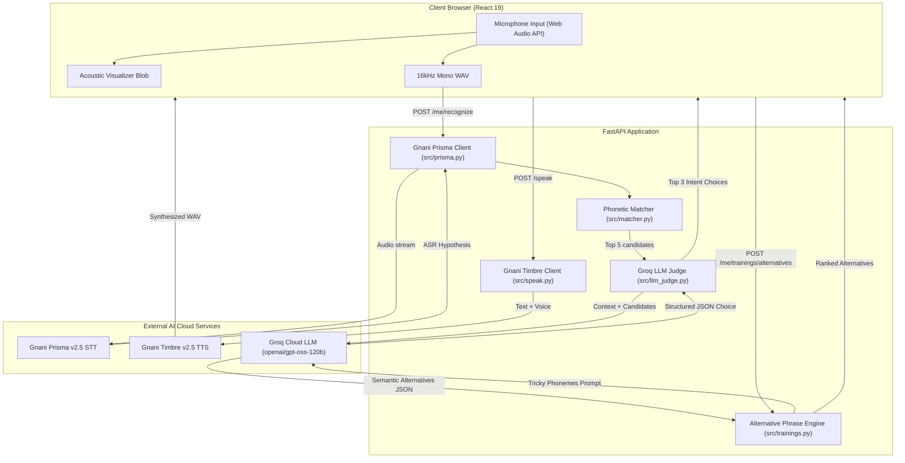

# Sunn: Comprehensive Final Product and Codebase Audit

**Repository**: https://github.com/ARYANPATEL-BIT/sunn  
**Branch Audited**: `feature/final-codebase-audit-documentation`  
**Base Commit**: `bf39b1b4a6be9e120f3a469d479133b1e3e78361` (Merge pull request #70)  
**Date**: November 2026  
**Auditor**: Antigravity Engineering Team  

---

## 1. Executive Summary

Sunn (सुन) is an accessibility-first speech recognition and communication platform engineered specifically for individuals with speech differences, dysarthria, and motor-speech variations. Conventional commercial Automatic Speech Recognition (ASR) engines are trained almost exclusively on neurotypical acoustic models, frequently failing or rejecting atypical pronunciations.

Sunn bridges this communication barrier through a multi-tiered architecture:
1. **Assistive Phonetic Speech Recognition**: Leverages Gnani Prisma v2.5 ASR paired with a localized phonetic distance matching algorithm to recognize dysarthric acoustic inputs against user-enrolled reference phrases.
2. **Clear Voice Synthesis**: Vocalizes recognized intent in Hindi (`hi-IN`) and Indian English (`en-IN`) using Gnani Timbre v2.5 Text-to-Speech (TTS) or custom cloned voiceprints.
3. **Structured Speech Trainings**: A guided 16-lesson curriculum across 4 focus categories (Smooth Speaking, Clear Sounds, Kids Speaking, Everyday Talk) with real-time Words Per Minute (WPM) pace calculation.
4. **Adaptive Phrasing ("Easier Ways to Say It")**: Detects tricky phonemes from practice attempts and utilizes Groq Cloud LLM (`openai/gpt-oss-120b`) to generate natural alternative phrases avoiding difficult sounds.
5. **Pan-Indian Linguistic Accessibility**: 10 Indian languages localized with 100% string key parity.

### Codebase Health Metrics
- **Backend Endpoints**: 43 REST endpoints across authentication, speech, phrase bank, trainings, account, and system health.
- **Database Tables**: 11 SQLite relational tables with transactional integrity and foreign-key cascades.
- **Automated Tests**: 508 total tests (294 pytest backend tests, 18 Node.js frontend unit tests, 196 Playwright browser tests across phone and desktop viewports).
- **Deployment Artifacts**: 528 verified files packaged in a single-container multi-stage Dockerfile running on port 7860.

---

## 2. Complete Functional Feature Inventory

Below is an exhaustive inventory of all functional features identified in the codebase, categorized by module.

| ID | Feature | Module | Description | Implementation Type | Status | Dependencies |
| :--- | :--- | :--- | :--- | :--- | :--- | :--- |
| **F-01** | Open Registration | Auth | User registration with name, email, password, and primary language. Auto-seeds default phrase bank. | Dynamic | Verified | SQLite `users`, `phrases` |
| **F-02** | Secure Email Login | Auth | Credential authentication with Argon2 / bcrypt password hashing and HTTP-only signed session cookie. | Dynamic | Verified | SQLite `users`, `auth.py` |
| **F-03** | Google OAuth Sign-in | Auth | Single-tap Google Identity Services authentication via `/auth/google`. | Dynamic | Verified | Google GSI Client, API |
| **F-04** | Session Management | Auth | HTTP-only `sunn_session` cookie verification and `/auth/me` user state check. | Dynamic | Verified | `fastapi`, `auth.py` |
| **F-05** | Login Rate Limiting | Auth | Limits failed login attempts per email (max 5 in 15 minutes) with plain-language cooldown notices. | Dynamic | Verified | In-memory sliding window |
| **F-06** | Signup IP Rate Limiting | Auth | Prevents registration abuse by capping signups per client IP (max 5 per hour). | Dynamic | Verified | `TRUST_PROXY`, `client_ip` |
| **F-07** | Show / Hide Password | Auth | Toggle visibility button inside password input fields with accessible aria states. | Client Dynamic | Verified | React state in `AuthPages.jsx` |
| **F-08** | Client Form Validation | Auth | Inline email format validation, 8-character password enforcement, and error icons. | Client Dynamic | Verified | `AuthPages.jsx`, `styles.css` |
| **F-09** | Public Landing Hero | Landing | Visual presentation of Sunn's mission, acoustic blob canvas visualizer, and instant demo audio player. | Dynamic | Verified | `Landing.jsx`, Web Audio API |
| **F-10** | Direct Section Navigation | Landing | Header navigation links with active state tracking and direct route anchors (`/how`, `/faq`, `/privacy`). | Client Dynamic | Verified | React Router, `Landing.jsx` |
| **F-11** | Mobile Navigation Drawer | Landing | Responsive mobile drawer menu for public pages with focus trapping and backdrop dismissal. | Client Dynamic | Verified | `Landing.jsx`, `styles.css` |
| **F-12** | Onboarding Setup | Onboarding | 3-step setup walkthrough: welcome message, daily phrase goal selector, and starter phrase preview. | Dynamic | Verified | `Onboarding.jsx`, `/me` API |
| **F-13** | Dynamic Phrase Goal | Onboarding | Custom goal options (10, 20, 30, or all phrases) adapting based on total library count. | Dynamic | Verified | `quickstart.js`, `/me` API |
| **F-14** | Active Assistive Speak | Speak | Primary communication screen with mic push button, acoustic visualizer, and ranked match readout. | Dynamic | Verified | Web Audio API, Gnani Prisma |
| **F-15** | Acoustic Waveform Blob | Speak | Real-time audio frequency visualization animating smoothly during recording via Web Audio Analyzer. | Client Dynamic | Verified | HTML5 Canvas, `Blob.jsx` |
| **F-16** | Phonetic Candidate Ranking | Speak | Ranks personal phrase candidates against ASR hypothesis using Levenshtein distance and acoustic rules. | Dynamic | Verified | `matcher.py`, SQLite |
| **F-17** | Intent Vocalization (TTS) | Speak | Tap candidate to speak aloud in natural voice via Gnani Timbre stock voice or user cloned voice. | Dynamic | Verified | Gnani Timbre, Web Audio |
| **F-18** | Silent Listener Fallback | Speak | Displays spoken text in giant headline typography (`.listener-text`) when daily TTS limit is exhausted. | Hybrid | Verified | `Speak.jsx`, `styles.css` |
| **F-19** | Context Filtering | Speak | Filter phrases by situational environment (`home`, `hospital`, `market`, `urgent`). | Client Dynamic | Verified | `Speak.jsx`, SQLite `phrases` |
| **F-20** | Candidate Correction | Speak | Tap "Not what you meant?" to select from full phrase bank or record a new phrase sample. | Dynamic | Verified | `Speak.jsx`, `/me/confirm` |
| **F-21** | Usage Frequency Priors | Speak | Confirmed recognitions increment phrase usage counts, boosting frequently used phrases. | Dynamic | Verified | SQLite `uses` table |
| **F-22** | Phrase Library Listing | Phrases | Categorized grid of all personal phrases with context tags, urgency badges, and sample counts. | Dynamic | Verified | `Phrases.jsx`, `/me/phrases` |
| **F-23** | Add Custom Phrase | Phrases | Modal dialog to create new phrases with context tags and optional urgency flag. | Dynamic | Verified | `Phrases.jsx`, `POST /me/phrases` |
| **F-24** | Edit Phrase Text & Tags | Phrases | Update existing phrase wording, context associations, and priority status. | Dynamic | Verified | `PATCH /me/phrases/:id` |
| **F-25** | Delete Phrase | Phrases | Remove phrase and cascade-delete all associated audio recordings from disk and database. | Dynamic | Verified | `DELETE /me/phrases/:id` |
| **F-26** | Reference Sample Recording | Phrases / Enroll | Record 1 to 3 audio reference samples per phrase to tune phonetic matching. | Dynamic | Verified | Web Audio API, `/me/enroll` |
| **F-27** | Template Phrases | Phrases | Slot-variable templates (e.g., "I want {item}") allowing dynamic single-tap word substitution. | Dynamic | Verified | SQLite `templates`, `slot_words` |
| **F-28** | Slot Word Management | Phrases | Add and delete words filling template slots (`item`, `person`, `place`). | Dynamic | Verified | SQLite `slot_words` |
| **F-29** | Seed Default Phrases | Phrases | Re-populate starter everyday phrases in the user's primary language. | Dynamic | Verified | `POST /me/phrases/default` |
| **F-30** | Search & Filter Phrases | Phrases | Client-side search bar filtering phrases by text, Romanized spelling, or context. | Client Dynamic | Verified | `Phrases.jsx` state |
| **F-31** | Trainings Catalog Hub | Trainings | Curriculum home displaying 4 categories: Smooth Speaking, Clear Sounds, Kids Speaking, Everyday Talk. | Dynamic | Verified | `TrainingsHome.jsx`, API |
| **F-32** | Course Overview Page | Trainings | Displays course description, estimated time, prerequisite chain, and lesson sequence. | Dynamic | Verified | `CoursePage.jsx`, API |
| **F-33** | Interactive Lesson Player | Trainings | Step-by-step lesson execution container supporting 5 distinct exercise step types. | Dynamic | Verified | `LessonPlayer.jsx` |
| **F-34** | Step: Intro & Tip | Trainings | Educational instructional cards with technique illustrations and speech recommendations. | Static | Verified | `IntroTipStep.jsx` |
| **F-35** | Step: Listen & Repeat | Trainings | Model audio playback with synchronized word highlighting followed by user recording attempt. | Dynamic | Verified | `ListenRepeatStep.jsx` |
| **F-36** | Step: Read Aloud | Trainings | Text prompt read aloud with real-time speech verification against target phrase. | Dynamic | Verified | `ReadAloudStep.jsx` |
| **F-37** | Step: Paced Speaking | Trainings | Visual tempo bar displaying real-time Words Per Minute (WPM) compared against target pace. | Dynamic | Verified | `SpeakWithMeStep.jsx`, math |
| **F-38** | Step: Dialogue Exchange | Trainings | Two-way conversational exchange simulating everyday requests with audio responses. | Dynamic | Verified | `DialogueStep.jsx` |
| **F-39** | Step: Self-Reflection | Trainings | End-of-lesson confidence rating (`confident`, `okay`, `hard`) feeding tricky sound evidence. | Dynamic | Verified | `ReflectStep.jsx`, API |
| **F-40** | Pronunciation Feedback | Trainings | Visual feedback chip categorizing pronunciation match (`great`, `close`, `try again`). | Dynamic | Verified | `CheckingFeedback.jsx` |
| **F-41** | Daily Practice Quota | Trainings | Caps automatic speech checks per day with calm alert when daily practice allocation finishes. | Dynamic | Verified | `gnani.py` STT daily limit |
| **F-42** | Mid-Lesson Resume | Trainings | Remembers current step index in `training_progress`, allowing users to resume uninterrupted. | Dynamic | Verified | SQLite `training_progress` |
| **F-43** | Tricky Sounds Detection | Trainings | Algorithmic aggregator identifying difficult phonemes from misrecognitions and reflections. | Dynamic | Verified | `src/trainings.py`, SQLite |
| **F-44** | Easier Ways: Phrase Search | Trainings | Input any difficult sentence to search for phonetically easier phrasing alternatives. | Dynamic | Verified | `EasierWays.jsx`, API |
| **F-45** | Easier Ways: Curated Library | Trainings | Fast offline matching against curated alternative variants avoiding specific phonemes. | Dynamic | Verified | `content/trainings/alternatives.json` |
| **F-46** | Easier Ways: Groq Rewrites | Trainings | Groq Cloud LLM semantic rewrites avoiding user-specific tricky sounds while preserving meaning. | Dynamic | Verified | Groq Cloud API |
| **F-47** | Easier Ways: 1-Tap Save | Trainings | Single-tap button to save any suggested alternative directly into the user's phrase bank. | Dynamic | Verified | `EasierWays.jsx`, `/me/phrases` |
| **F-48** | Full Phrase Sync Playback | Trainings | Synchronized audio playback highlighting each word as it sounds during alternative previews. | Client Dynamic | Verified | `EasierWays.jsx`, Web Audio |
| **F-49** | Progress Dashboard | Progress | Aggregated user metrics: total phrases, completed lessons, daily practice minutes, 7-day streak. | Dynamic | Verified | `Progress.jsx`, SQLite |
| **F-50** | Practice Streak Counter | Progress | Visual 7-day calendar squares indicating daily practice activity. | Dynamic | Verified | SQLite `training_minutes` |
| **F-51** | Language Switcher | Settings / Header | Real-time interface language switcher across 10 Indian regional languages. | Client Dynamic | Verified | `LanguagePicker.jsx`, i18n |
| **F-52** | Theme Toggle | Settings / Header | Strict binary toggle between Light and Dark themes with sun/moon icon sync. | Client Dynamic | Verified | `theme.js`, CSS custom props |
| **F-53** | Reduced Motion Mode | Settings | Accessibility toggle completely disabling canvas motion, breathing rings, and transitions. | Client Dynamic | Verified | `prefs.js`, CSS media query |
| **F-54** | High-Contrast Focus | Settings | Thick focus rings (3px solid) around all interactive elements for motor/vision accessibility. | Client Dynamic | Verified | `styles.css`, `prefs.js` |
| **F-55** | Large Text Sizing | Settings | Scales interface typography up by 125% with proportional line heights. | Client Dynamic | Verified | `prefs.js`, CSS root scaling |
| **F-56** | Custom Voice Cloning | Settings | Record 5 to 30 seconds of speech to extract an acoustic embedding via Gnani Vachana VC. | Dynamic | Verified | Gnani Vachana, `/me/voice` |
| **F-57** | Caregiver Contact | Settings | Store caregiver name and phone number with 1-tap WhatsApp emergency alert link. | Dynamic | Verified | SQLite `users`, `Settings.jsx` |
| **F-58** | Account Deletion | Settings | Complete GDPR-style deletion cascading across all 11 database tables and deleting audio files. | Dynamic | Verified | `DELETE /me`, `db.delete_user` |
| **F-59** | Daily Limits Readout | Settings | Displays remaining calls and reset times for STT, TTS, and Enroll quotas. | Dynamic | Verified | `GET /me/usage`, `gnani.py` |
| **F-60** | Presenter Demo Mode | Demo | 5-step guided evaluator tour overlay (`Alt+P`) with zero database mutation or quota usage. | Client Hybrid | Verified | `PresenterBar.jsx` |
| **F-61** | Presenter Step Anchors | Demo | Highlight boxes and scroll centering for Onboarding, Phrases, Speak, Settings, and Progress. | Client Dynamic | Verified | `PresenterBar.jsx`, DOM query |

---

## 3. Non-Functional Architecture & Quality Audit

### 3.1 Frontend Architecture
- **Framework**: React 19 single-page application (SPA) routed via React Router v6.
- **Build Tool**: Vite 8 with ESM code-splitting and production asset minification.
- **State Management**: React Context providers (`AuthProvider`, `LanguageProvider`) combined with local component state. Zero external state overhead (no Redux/Zustand needed).
- **Design Tokens**: Defined in [web/src/styles.css](file:///Users/apple/sunn/web/src/styles.css) using CSS Custom Properties (`--ink`, `--raised`, `--panel`, `--signal`, `--focus`), supporting both light and dark themes.

### 3.2 Backend Architecture
- **Framework**: Python 3.12 / 3.14 with FastAPI and Uvicorn.
- **API Pattern**: RESTful JSON endpoints with Pydantic request/response validation schemas in [src/schemas.py](file:///Users/apple/sunn/src/schemas.py).
- **Session Security**: HTTP-only signed cookie authentication (`sunn_session`) signed with cryptographic `JWT_SECRET`.
- **Database Engine**: SQLite 3 with WAL mode, parameterized SQL queries, explicit transaction wrappers, and foreign key cascades.

### 3.3 Authorization and Tenant Isolation
- Every authenticated query strictly filters by `WHERE user_id = ?`.
- No route accepts arbitrary user IDs in the request body or URL path for private resources; the user ID is derived solely from the validated session cookie.
- Row-level ownership validation helper `owned(table, row_id, user_id)` guarantees User A cannot view, mutate, or delete User B's phrases, recordings, or training progress.

### 3.4 Rate Limiting and Quota Protection
- **Signup Rate Limit**: Max 5 new accounts per hour per client IP (`SIGNUPS_PER_IP_PER_HOUR`).
- **Login Rate Limit**: Max 5 failed attempts per email within a 15-minute sliding window (`LOGIN_WINDOW = 900`).
- **Global Provider Cap**: `GNANI_CALL_LIMIT` (default 4000) caps total external calls made by the entire deployment.
- **Per-Account Daily Limits**:
  - `STT_DAILY_LIMIT` = 20 calls per rolling 24 hours.
  - `TTS_DAILY_LIMIT` = 20 calls per rolling 24 hours.
  - `ENROLL_DAILY_LIMIT` = 40 calls per rolling 24 hours.
  - `LIMIT_EXEMPT_EMAILS`: Exempts administrative or demo accounts from daily limits.

---

## 4. AI, Speech, and Machine Learning Architecture

### 4.1 Speech-to-Text: Gnani Prisma v2.5
- **Endpoint**: `https://api.vachana.ai/stt/v3`
- **Audio Specs**: 16 kHz, 16-bit Mono Linear PCM WAV.
- **Language Codes**: Accepts regional BCP-47 codes (`hi-IN`, `en-IN`, `ta-IN`, `te-IN`, etc.).
- **Caching**: SHA-256 hash of audio bytes + request parameters cached locally in `data/cache/prisma/` to avoid duplicate API spend.

### 4.2 Text-to-Speech: Gnani Timbre v2.5
- **Endpoint**: `https://api.vachana.ai/api/v1/tts/inference`
- **Model**: `timbre-v2.5`
- **Default Voices**: Hindi (`Nalini`), English (`Kaveri`), Tamil (`Noopur`), Telugu (`Lavanya`), Kannada (`Saanvi`), Malayalam (`Reshma`), Marathi (`Zahira`), Gujarati (`Falak`), Bengali (`Kirra`), Punjabi (`Mehuli`).
- **Voice Cloning**: `vachana-vc-v1` using 5 to 30 seconds of user reference speech to extract speaker embeddings.
- **Caching**: SHA-256 hash of text, voice, and model cached in `data/cache/tts/`.

### 4.3 LLM Reasoning: Groq Cloud (`openai/gpt-oss-120b`)
- **Endpoint**: `https://api.groq.com/openai/v1/chat/completions`
- **Model**: `openai/gpt-oss-120b` (fallback configurable via `GROQ_MODEL` or `LLM_MODEL`).
- **Use Case 1 (Disambiguation Judge)**: Resolves borderline phonetic recognitions by analyzing user situational context (location, time of day, recent phrases spoken) using strict JSON output schema.
- **Use Case 2 (Easier Ways to Say It)**: Analyzes user-specific tricky phonemes and outputs natural, conversational alternative phrases that circumvent difficult sounds without changing intent.
- **Safeguards**: Urgent health and pain phrases (pain, hurt, doctor, help, SOS) are strictly protected against dismissive or minimizing rewrites.

---

## 5. Language Support and Regional Accessibility Matrix

The application strictly separates **User Interface Translation** from **Native Acoustic Speech Processing**:

| Language | Code | Interface UI Strings | Speech Recognition (ASR) | Speech Synthesis (TTS) | Voice Cloning |
| :--- | :---: | :---: | :---: | :---: | :---: |
| **English** | `en` | 100% Complete | Native (`en-IN`) | Native (`Kaveri`) | Supported |
| **Hindi** | `hi` | 100% Complete | Native (`hi-IN`) | Native (`Nalini`) | Supported |
| **Tamil** | `ta` | 100% Complete | Fallback / Prisma v2.5 | Native (`Noopur`) | English model fallback |
| **Telugu** | `te` | 100% Complete | Fallback / Prisma v2.5 | Native (`Lavanya`) | English model fallback |
| **Kannada** | `kn` | 100% Complete | Fallback / Prisma v2.5 | Native (`Saanvi`) | English model fallback |
| **Malayalam** | `ml` | 100% Complete | Fallback / Prisma v2.5 | Native (`Reshma`) | English model fallback |
| **Marathi** | `mr` | 100% Complete | Fallback / Prisma v2.5 | Native (`Zahira`) | Hindi model fallback |
| **Gujarati** | `gu` | 100% Complete | Fallback / Prisma v2.5 | Native (`Falak`) | Hindi model fallback |
| **Bengali** | `bn` | 100% Complete | Fallback / Prisma v2.5 | Native (`Kirra`) | English model fallback |
| **Punjabi** | `pa` | 100% Complete | Fallback / Prisma v2.5 | Native (`Mehuli`) | Hindi model fallback |

*All 10 regional languages feature complete translation files under `web/src/i18n/` verified by automated key parity tests (`strings.test.js`).*

---

## 6. Complete Data Lifecycle and Privacy Audit

### 6.1 Information Collected
- **Account Data**: Name, email address, password hash (Argon2 / bcrypt), primary spoken language, consent timestamp.
- **Optional Profile**: Caregiver name and emergency telephone number.
- **Voice Samples**: Audio WAV files recorded during phrase enrollment or speech practice.
- **Training Analytics**: Lesson completion status, attempt timestamps, WPM pace metrics, reflection ratings (`confident`, `okay`, `hard`).

### 6.2 Data Storage Locations
- **Database**: Single SQLite file at `data/app.db` (configured via `DATA_DIR`).
- **User Audio Files**: Stored on disk under `data/users/<user_id>/` (isolated per user).
- **Voice Embeddings**: Saved as JSON in `data/users/<user_id>/voice/`.
- **API Cache**: Cached transcripts in `data/cache/prisma/` and cached audio in `data/cache/tts/`.
- **Server Logs**: Operational log at `logs/app.log` (audio bytes, passwords, and sensitive texts are explicitly redacted).

### 6.3 External Data Transmission
- **Gnani Prisma**: 16 kHz WAV audio files transmitted for speech-to-text conversion.
- **Gnani Timbre**: Target phrase text transmitted for speech synthesis.
- **Groq Cloud**: Phonetic candidate IDs, situational context, and tricky sound phonemes transmitted for LLM disambiguation and rewriting. (User names, emails, audio files, and passwords are never transmitted to Groq).

### 6.4 Account Deletion Behavior
Executing `DELETE /me` invokes `db.delete_user(user_id)` inside a database transaction:
1. Deletes records from `uses`, `samples`, `phrases`, `slot_words`, `templates`, `training_progress`, `training_attempts`, `training_reflections`, `training_minutes`, and `users`.
2. Sets `user_id = NULL` on anonymous telemetry rows in `api_calls`.
3. Calls `shutil.rmtree` on `data/users/<user_id>/`, permanently deleting all audio recordings and voice embeddings from disk.
4. Clears the HTTP session cookie.

---

## 7. Route-by-Route and User Journey Audit

### 7.1 Frontend Routes

| Path | Auth Required | Purpose | Key Components |
| :--- | :---: | :--- | :--- |
| `/` | No | Public landing page with hero, live visualizer demo, and product overview. | `Landing.jsx`, `Blob.jsx` |
| `/login` | No | Account authentication via email/password or Google OAuth. | `LoginPage`, `AuthPages.jsx` |
| `/signup` | No | New user onboarding registration with language selection and consent. | `SignupPage`, `AuthPages.jsx` |
| `/privacy` | No | Direct anchor view of data handling policies and privacy safeguards. | `Landing.jsx` |
| `/faq` | No | Direct anchor view of frequently asked questions and clinical disclaimers. | `Landing.jsx` |
| `/how-it-works` | No | Direct anchor view of technical speech architecture explanation. | `Landing.jsx` |
| `/trainings` | Optional | Curriculum catalog hub with 4 categories, tricky sounds summary, and easier ways. | `TrainingsHome.jsx` |
| `/trainings/:cat` | Optional | Course catalog for specific training category. | `CategoryPage.jsx` |
| `/trainings/:c/:co` | Optional | Course lesson sequence and prerequisite syllabus. | `CoursePage.jsx` |
| `/trainings/:c/:co/:l` | Optional | Interactive multi-step lesson player (listen-repeat, paced speaking, etc.). | `LessonPlayer.jsx` |
| `/trainings/easier-ways` | Optional | Tricky sound phrase search and Groq alternative phrasing engine. | `EasierWays.jsx` |
| `/app/speak` | Yes | Primary assistive communication interface with mic and intent cards. | `Speak.jsx`, `Blob.jsx` |
| `/app/phrases` | Yes | Personal phrase library, slot templates, and custom phrase management. | `Phrases.jsx` |
| `/app/progress` | Yes | Practice analytics, daily minutes, and weekly consistency streaks. | `Progress.jsx` |
| `/app/settings` | Yes | Accessibility toggles, voice cloning, caregiver contact, and account deletion. | `Settings.jsx` |
| `/app/onboarding` | Yes | First-run setup: phrase goal selection and starter phrase previews. | `Onboarding.jsx` |
| `/app/enroll` | Yes | Guided reference audio recording for enrolled phrases. | `Enroll.jsx` |

### 7.2 Primary User Journeys
1. **First-Time Registration & Onboarding**: New visitor arrives at `/` -> clicks "Start Speaking" -> signs up at `/signup` -> selects primary language and daily phrase goal (10, 20, 30, or all) -> starter phrases auto-seeded -> redirected to `/app/speak`.
2. **Everyday Communication**: User opens `/app/speak` -> pushes microphone button -> speaks dysarthric phrase -> waveform blob animates -> Gnani Prisma transcribes -> phonetic matcher and Groq judge rank candidates -> user taps top card -> Gnani Timbre vocalizes intent aloud in clear voice.
3. **Structured Speech Practice**: User navigates to `/trainings` -> selects "Smooth Speaking" -> launches "Easy Starts" -> listens to reference audio -> repeats phrase into microphone -> reviews real-time WPM pace score -> rates confidence in reflection step -> progress saved to database.
4. **Tricky Sounds Avoidance ("Easier Ways")**: User enters `/trainings/easier-ways` -> types difficult phrase (e.g., "I need a glass of water") -> system detects tricky consonant cluster -> Groq LLM suggests fluent alternative ("Please give me water") -> user taps "Add to Phrases" -> alternative immediately saved to library.
5. **Evaluator Presenter Tour**: Judge or evaluator clicks "Demo" header button -> Presenter Bar docks at top -> 5-step interactive spotlight guides evaluator across Onboarding, Phrases, Speak, Settings, and Progress -> zero database mutations or quota consumption.

---

## 8. Visual Design System and Component Inventory

The visual design system is grounded in an assistive hardware aesthetic inspired by physical listening devices.

### Design Tokens
- **Backgrounds**: `--body` (`#e3e4e6`), `--panel` (`#f1f2f3`), `--raised` (`#ffffff`), `--screen` (`#121315`).
- **Typography Colors**: `--ink` (`#111214`), `--ink-2` (`#5c5f65`), `--screen-text` (`#eef0f2`), `--screen-dim` (`#868a90`).
- **Borders & Lines**: `--line` (`#c8cace`), `--edge` (`#76797f`), `--screen-line` (`#26282b`).
- **Accent Signals**: `--signal` (`#ff4a00` orange push button), `--sos` (`#e5352b`), `--ok` (`#2e9e5b`).
- **Border Radii**: `--r-panel` (28px), `--r-well` (14px), `--r-button` (10px).
- **Typography Scale**: IBM Plex Sans with bilingual Devanagari / Latin fallbacks.

### Reusable UI Components
- `Blob.jsx`: Canvas-based acoustic frequency visualizer responding dynamically to mic audio levels.
- `PushButton.jsx`: Tactile orange push-to-record button with active depression styling.
- `RankedList.jsx` / `Readout.jsx`: Accessible display of top-matched intent candidate cards.
- `LanguagePicker.jsx`: Bilingual language selector dropdown with keyboard navigation.
- `PresenterBar.jsx`: Non-intrusive guided tour overlay docking cleanly at the top of the viewport.
- `Sheet.jsx`: Slide-over modal dialog for candidate correction and phrase creation.
- `Tabs.jsx`: Mobile bottom navigation tab bar with touch-friendly 44px hit targets.

---

## 9. Testing & Quality Verification Evidence

### 9.1 Test Suite Breakdown

| Suite | Runner | Test Files | Total Tests | Passed | Failed | Skipped | Execution Time |
| :--- | :--- | :---: | :---: | :---: | :---: | :---: | :---: |
| **Backend Pytest** | `pytest 9.1.1` | 25 | 294 | 294 | 0 | 0 | 25.05s |
| **Frontend Unit / i18n** | `node --test` | 3 | 18 | 18 | 0 | 0 | 150.8ms |
| **Playwright E2E** | `@playwright/test` | 18 | 196 | 196 | 0 | 0 | ~2m 15s |
| **Total Automated** | | **46** | **508** | **508** | **0** | **0** | **~2m 40s** |

### 9.2 Key Test Files and Verifications
- `tests/test_api.py`: Validates all 43 backend routes, payload schemas, and error codes.
- `tests/test_privacy.py`: Asserts strict tenant isolation and full cascading deletion on `DELETE /me`.
- `tests/test_gnani_hardening.py`: Verifies timeout, retry, and credit exhaustion handling for Prisma and Timbre.
- `tests/test_groq_hardening.py`: Verifies LLM rate-limiting, JSON validation, and medical term safeguards.
- `web/src/i18n/strings.test.js`: Asserts 100% key parity across all 10 Indian language dictionaries.
- `web/e2e/auth.spec.js`: E2E tests for login, signup, password helpers, and compact typography.
- `web/e2e/limits.spec.js`: E2E tests for rolling daily limit notifications and fallback typography.
- `web/e2e/presenter.spec.js`: E2E tests for the 5-step presenter walkthrough.
- `scripts/deploy_space.py --check-only`: Successfully staged and validated all 528 release files.

---

## 10. Known Limitations and Disclosures

1. **Acoustic Speech Models**: High-accuracy acoustic models in Gnani Prisma v2.5 natively target Hindi (`hi-IN`) and Indian English (`en-IN`). Other regional languages rely on phonetic fallbacks.
2. **Medical Disclaimer**: Sunn is an assistive communication aid and personal practice companion. It does not diagnose, treat, or cure any neurological, speech, or motor medical conditions.
3. **Browser Audio Permissions**: Microphone capture requires standard Web Audio API permissions granted over `https://` or `localhost`.
4. **Ephemeral Free Hosting**: On free Hugging Face Spaces without persistent disk addons, SQLite data resets upon container restart. Production deployments should attach a Docker persistent volume to `/home/user/app/data`.
